# Technical architecture: Professional Directory, Networking and Mentorship Platform

This document describes how the member platform for Muslim Engineers in Science & Tech (MEST) will be built: the stack, how the backend is organized, the full database schema, authentication and Row Level Security, privacy, integrations, account deletion, and how the system stays maintainable for a volunteer organization. Product requirements are in [01-product-requirements.md](01-product-requirements.md); requirement IDs such as REQ-4 refer to that file. Screens are in [03-ux-information-architecture.md](03-ux-information-architecture.md), build order in [04-implementation-roadmap.md](04-implementation-roadmap.md) and the task-by-task plan for the first release in [06-build-plan-phase-1.md](06-build-plan-phase-1.md).

Revised 2026-11-23 for the hosting decision recorded in [05-open-questions.md](05-open-questions.md): the platform runs as one Node service with Postgres on Railway rather than on Supabase. Where this document and the build plan differ, the build plan's task text wins; this document is the reference for every table column, policy row, function signature and notification.

Examples that name people (Layla Haddad, Amina Rahman, Musa Grant) come from the prototype's `src/preview/network/data/mock.ts` and are fictional.

## 1. Starting point

The repository today is a single-page static landing site: React 19, TypeScript, Vite 6, Tailwind CSS 4, GSAP and lucide-react. There is no router, no backend, no authentication and no database. Content lives in `src/content/site.ts`, design tokens in `src/styles.css` under `@theme`, and the build output in `dist/` is served from static hosting.

The prototype under `src/preview/network/` is frontend-only. It uses a small hash router (`router.tsx`) so that nothing about the production page's path handling changes, fictional data from `data/mock.ts`, and vocabularies from `data/taxonomy.ts`. Its types in `data/types.ts` are the shapes this schema is derived from.

## 2. Recommended stack

### 2.1 Decision: Node API and Postgres on Railway

The platform is one Node 22 service and one Postgres database, both on Railway. The service (Hono) serves the API under `/api/*`, the existing landing page at `/`, and the network app under `/network/*`. Railway Postgres holds all data. Reasons:

1. **One vendor the organizer already uses.** MEST's other projects deploy to Railway, so the accounts, billing, dashboards and habits exist. No second vendor to learn, pay or hand over.
2. **The fallback rewrite is ours.** Deep links such as `/network/directory/:id` need `index.html` served for unknown paths under `/network` and a real 404 everywhere else. A service we write does exactly that, and injects the title and Open Graph tags for public profiles on the way out, which static hosting could not do.
3. **One deploy.** The frontend build and the API ship together as one Docker image from one repository. There is no separate static host, no CORS between origins, and no second pipeline to keep in step.
4. **Privacy still maps directly to the database.** Every "who can see this" rule in the requirements is a row-level or column-level rule. Postgres Row Level Security (RLS) expresses those rules once, in the database, where every query has to obey them. The API runs every request as a database role that cannot bypass RLS, so a bug in a route cannot return a phone number the policy does not return.
5. **Portability.** The data is ordinary Postgres. An export is a `pg_dump`. The schema, policies and functions are plain SQL migrations and move to any Postgres host unchanged.

Trade-off accepted: authentication, sessions, email sending and the request helpers are our code rather than a managed product. The mitigation is to keep that code small and boring (magic links and Google only, no passwords, a sessions table, an outbox table) and to keep every authorization rule in RLS and `SECURITY DEFINER` SQL functions, where it was going to live anyway. The TypeScript service layer validates input and calls those functions; it never decides who may see what.

Alternatives considered:

| Option | Why not |
| --- | --- |
| Supabase (managed Postgres, Auth, Edge Functions) | The earlier recommendation, and still a good product. It adds a second vendor and a second set of accounts to the organizer's Railway setup, its free tier pauses idle projects, the SPA fallback and public-profile meta tags would still need a host that can rewrite paths, and its `auth.users` table and Edge Function runtime tie the auth code to the vendor. The RLS and SQL function design carries over unchanged, so the switch cost only the Supabase-specific pieces |
| Firebase (Firestore) | Document model fits a relational directory poorly (many-to-many tags, requests joining two people). Security rules are harder to audit for field-level privacy than SQL policies, and data export is not a standard format |
| No-code tools (Airtable, Softr and similar) | Per-field privacy is weak or absent, the data is locked to the vendor, the brand and accessibility are constrained by the tool, and per-seat pricing grows with the membership |

### 2.2 Frontend

| Concern | Choice | Notes |
| --- | --- | --- |
| Framework | React 19, Vite 6, TypeScript, Tailwind CSS 4 | Unchanged. The platform reuses the `@theme` tokens, type roles and components from the landing page, and the prototype's `pn-*` stylesheet and controls move to `src/network/ui/` |
| Routing | React Router 7 in library mode | Path routes under `/network/...`. The prototype's hash router is replaced. The server serves `index.html` for unknown `/network/*` paths only |
| Data layer | TanStack Query 5 over `fetch` to `/api` | Same origin, cookie session, `credentials: 'include'`. Caching, retries and background refresh without hand-written loading state. Query keys mirror resources |
| Forms | react-hook-form 7 with zod 3 schemas from `shared/schemas/` | The same zod schemas validate on the client and in the API; the numbers in them come from `shared/limits.ts` and match the SQL `CHECK` constraints |
| Error monitoring | None in Phase 1 | Sentry is deferred to Phase 2 |
| Email | Resend SDK called from the server's outbox job | Transactional only. Templates live in the repository under `server/src/email/templates/` |
| Hosting | The same Node service serves `dist/` | One origin; no CORS |

### 2.3 Server

| Concern | Choice | Notes |
| --- | --- | --- |
| Runtime | Node 22, TypeScript | `tsx` in development, `esbuild` bundles `server/src/index.ts` to `server/dist/index.js` for the image; both resolve `@shared/*` from `tsconfig` paths |
| HTTP | Hono 4 | Sub-apps per area mounted under `/api`; a global error handler; an Origin check on every non-GET request |
| Database | `pg` 8, no ORM | SQL in numbered migrations under `server/migrations/`; parameterized queries in services |
| Validation | zod 3 | `validate(schema)` middleware answers `400 { code: 'validation', issues }` |
| Sign-in | Magic link (our code) and Google OAuth through `arctic` | No passwords. See section 5.1 |
| Email | Resend SDK | Drained from `email_outbox` by an in-process job; without an API key outside production the job marks rows sent and logs the text body, which is how a local magic link is read; in production a missing key is a recorded send failure, so a working sign-in link never reaches the logs |
| Jobs | In-process scheduler | One interval per job under a lock row in `job_runs`; see section 4.6 |
| Tests | vitest for the server and the shared schemas (policy and function tests run against a real Postgres), Playwright with `@axe-core/playwright` for end-to-end checks at 375 and 1280 | Every test database is private to its worker (`mest_test_<WORKTREE_ID>`) |

### 2.4 Repository layout

```
package.json                     web app (scripts unchanged) + workspaces ["server"] + all pinned dependencies
Dockerfile, railway.json, docker-compose.yml, .env.example, .github/workflows/ci.yml, playwright.config.ts
shared/                          imported as @shared/* by the web app and the server
  taxonomy.ts                    copied from the prototype; topics become { id, label }
  limits.ts                      every length and count limit, one place (section 4.3)
  schemas/*.ts                   zod: auth, onboarding, profile, settings, request, admin
  types/<area>.ts                API response types
server/
  package.json, tsconfig.json, vitest.config.ts
  migrations/0001..0009_*.sql    hand-written, numbered, forward-only
  src/index.ts                   Hono app, static dist, /network/* fallback, meta injection, health
  src/env.ts, src/db/{pool,migrate,tx}.ts, src/http/{errors,validate}.ts, src/audit.ts
  src/auth/{magic-link,google,session,middleware}.ts
  src/email/{resend,outbox,templates/*}.ts
  src/jobs/{scheduler,send-emails,expire-requests,reminders,resume-paused,retention,deletions,digest}.ts
  src/services/*.ts              input validation and calls to SQL functions and views
  src/routes/*.ts                one Hono sub-app per area
  src/cli/admin-grant.ts
  seed/*.ts                      development seed built from the prototype's mock.ts
  test/{harness.ts,db/*,auth/*,policies/*,services/*,email/*,jobs/*}
src/network/
  main.tsx, app/{router,routes,nav,shells,guards}.tsx, lib/{api,query,session,meta}.tsx
  ui/                            the prototype's ui.tsx, directory.tsx and network.css, moved
  features/{public,auth,onboarding,me,mentor,admin,settings,notifications}/*
e2e/*.spec.ts
docs/professional-network/       these documents plus runbook.md
```

The prototype under `src/preview/` stays until the real routes replace it, then is removed.

## 3. Backend organization

The service has four runtime pieces. Each has a defined job.

| Piece | Used for |
| --- | --- |
| Postgres (Railway) | All data, all authorization (RLS), all state transitions (`SECURITY DEFINER` SQL functions), the email outbox and the job lock rows |
| API (Hono) | Validates input, opens a transaction as the acting user, calls a SQL function or reads a view, returns the result. Magic link and Google sign-in, sessions and the cookie. Answers `/api/health` |
| Jobs (same process) | Draining the email outbox, request expiry, reminders, resuming paused mentors, retention, the deletion sweep and the weekly administrator digest. Each selects ids and calls a SQL function |
| Static serving (same process) | `dist/` for the landing page and the network app, with the `/network/*` fallback and server-injected meta tags for public profiles |

Rules of organization:

- **The database is the only place authorization lives.** The frontend never decides what a user may see; it asks and shows what comes back. Neither does the TypeScript service layer: it runs as a database role that RLS applies to.
- **Every request runs as the acting user.** `withUser(userId, fn)` opens a transaction with `BEGIN; SET LOCAL ROLE app_user; SELECT set_config('app.user_id', <id or ''>, true)` and commits or rolls back around `fn`. `app_user` is a `NOLOGIN` role without `BYPASSRLS`; it has the table grants the policies need and nothing more. `app_uid()` returns `nullif(current_setting('app.user_id', true), '')::uuid` and is what every helper and policy reads. An anonymous visitor runs with `app.user_id` empty, so `app_uid()` is null and only the public policies match.
- **`withSystem(fn)` runs as the table owner**, which bypasses RLS. It is allowed only in jobs (`server/src/jobs/*`), the pre-identity auth module (`server/src/auth/*`: token consumption, session lookup, user creation, rate-limit counts), the development seed and the `admin-grant` command line tool. Nothing else; a review checks every call site.
- **State transitions are SQL functions**, not row updates. A route cannot `UPDATE mentorship_requests SET status = 'accepted'`; it calls `respond_to_request(request_id, decision, note, decline_reason, share_methods)`, which checks that the caller is the mentor, the request is `pending`, the mentor has capacity, and writes the request, the relationship, the notification, the outbox row and the audit entry in one transaction. Every status transition and every write that touches another member's rows (requests, responses, approvals, notifications, audit, contact release, deletion) is such a function, `SECURITY DEFINER` with `SET search_path = public`, and its first statement checks the caller. Owner-guard triggers on protected columns pass when `current_user` is the table owner, which is how definer functions get through while an owner's direct `UPDATE` is refused.
- **Domain errors are SQL exceptions.** A function raises `mest.<code>` (for example `mest.mentor_full`); the API's error handler maps any Postgres error whose message starts with `mest.` to `409 { code }`. Other error shapes: `401 { code: 'unauthenticated' }`, `403 { code: 'not_member' }` or `{ code: 'not_admin' }`, `400 { code: 'validation', issues }`, `429 { code: 'rate_limited' }`, `404 { code: 'not_found' }`.
- **Services are thin.** They validate input with the shared zod schema, call a function or read a view inside `withUser`, and shape the response. List endpoints are paged `?page` (1-based) `&size` (default 20, max 50) and return `{ items, total }`.
- **Migrations are the source of truth.** Every schema change, policy and function is a numbered file in `server/migrations/`, applied in name order by `runMigrations(pool)` under `pg_advisory_lock(7231)` and recorded in `schema_migrations(name, applied_at)`. Nothing is changed by hand.

## 4. Data model

### 4.1 Entity relationship diagram

```mermaid
erDiagram
  users ||--|| profiles : "owns"
  users ||--o{ sessions : "signs in as"
  profiles ||--o| professional_details : "has"
  profiles ||--o| student_details : "has"
  profiles ||--o| mentorship_settings : "has"
  profiles ||--o| contact_preferences : "has"
  profiles ||--o| notification_preferences : "has"
  profiles ||--o| admin_roles : "may hold"
  profiles ||--o{ account_deletions : "may schedule"
  professional_details }o--|| disciplines : "in"
  professional_details ||--o{ education : "lists"
  profiles ||--o{ profile_expertise : "tagged"
  expertise_tags ||--o{ profile_expertise : "applied"
  mentorship_settings ||--o{ mentor_topics : "offers"
  mentorship_topics ||--o{ mentor_topics : "offered"
  profiles ||--o{ saved_profiles : "saves"
  profiles ||--o{ saved_profiles : "saved by"
  profiles ||--o{ mentorship_requests : "sends as mentee"
  profiles ||--o{ mentorship_requests : "receives as mentor"
  mentorship_topics ||--o{ mentorship_requests : "about"
  mentorship_requests ||--o| mentorship_relationships : "accepted into"
  mentorship_relationships ||--o{ meetings : "logs"
  mentorship_relationships ||--o{ availability_slots : "proposes"
  profiles ||--o{ notifications : "receives"
  notifications ||--o| email_outbox : "may queue"
  profiles ||--o{ profile_reviews : "reviewed"
  profiles ||--o{ profile_reviews : "reviews"
  profiles ||--o{ reports : "reported"
  profiles ||--o{ reports : "files"
  profiles ||--o{ audit_log : "acts"

  users {
    uuid id PK
    citext email
    timestamptz email_verified_at
    text google_sub
    timestamptz created_at
    timestamptz last_sign_in_at
    timestamptz suspended_at
    timestamptz deleted_at
  }
  sessions {
    text id PK
    uuid user_id FK
    timestamptz expires_at
    timestamptz created_at
    text user_agent
  }
  auth_tokens {
    uuid id PK
    citext email
    text token_hash
    text purpose
    timestamptz expires_at
    timestamptz used_at
    inet ip
    timestamptz created_at
  }
  profiles {
    uuid id PK
    text first_name
    text last_name
    text credentials
    enum kind
    text region
    text location
    text bio
    text linkedin_url
    text website_url
    enum visibility
    enum approval_state
    timestamptz mission_accepted_at
    timestamptz admin_hidden_at
    timestamptz last_active_at
    timestamptz anonymized_at
    tsvector search_tsv
    timestamptz created_at
    timestamptz updated_at
  }
  professional_details {
    uuid profile_id PK
    text title
    text organization
    text discipline_id FK
    int years_experience
    enum_array participation
    text_array interests
    bool verified
    enum verified_method
    timestamptz verified_at
    tsvector search_tsv
  }
  student_details {
    uuid profile_id PK
    text program
    enum level
    text institution
    text goals
    text_array interests
    text_array topics_needed
  }
  education {
    uuid id PK
    uuid profile_id FK
    text degree
    text field
    text school
    int year
  }
  disciplines {
    text id PK
    text label
    enum group_name
    int sort_order
    bool active
  }
  expertise_tags {
    uuid id PK
    text label
    text slug
    enum status
    uuid proposed_by FK
  }
  profile_expertise {
    uuid profile_id PK
    uuid tag_id PK
  }
  mentorship_topics {
    text id PK
    text label
    int sort_order
    bool active
  }
  mentorship_settings {
    uuid profile_id PK
    enum status
    enum previous_status
    date paused_until
    enum_array audience
    enum format
    enum mode
    text availability
    int duration_min
    int max_active
    timestamptz updated_at
  }
  mentor_topics {
    uuid profile_id PK
    text topic_id PK
  }
  contact_preferences {
    uuid profile_id PK
    enum_array methods
    enum_array share_with_members
    citext contact_email
    text phone
    text booking_url
    timestamptz updated_at
  }
  saved_profiles {
    uuid saver_id PK
    uuid saved_id PK
    timestamptz created_at
  }
  mentorship_requests {
    uuid id PK
    uuid mentee_id FK
    uuid mentor_id FK
    enum kind
    text topic_id FK
    text why
    text goals
    enum format
    enum mode
    text scheduling_note
    enum status
    timestamptz created_at
    timestamptz expires_at
    timestamptz responded_at
    text mentor_note
    text decline_reason
    int reminders_sent
  }
  mentorship_relationships {
    uuid id PK
    uuid request_id FK
    uuid mentee_id FK
    uuid mentor_id FK
    text topic_id FK
    enum_array shared_methods
    timestamptz started_at
    timestamptz completed_at
    uuid completed_by FK
  }
  meetings {
    uuid id PK
    uuid relationship_id FK
    timestamptz starts_at
    int duration_min
    enum mode
    text place
    text agenda
    enum status
    uuid created_by FK
  }
  availability_slots {
    uuid id PK
    uuid relationship_id FK
    uuid proposed_by FK
    timestamptz starts_at
    timestamptz ends_at
    enum status
  }
  notifications {
    uuid id PK
    uuid recipient_id FK
    enum category
    text subject_type
    uuid subject_id
    text title
    text body
    text link
    text template
    jsonb payload
    text email_status
    timestamptz created_at
    timestamptz read_at
  }
  email_outbox {
    uuid id PK
    uuid notification_id FK
    citext to_email
    text template
    jsonb payload
    int attempts
    text last_error
    timestamptz sent_at
    timestamptz created_at
  }
  notification_preferences {
    uuid profile_id PK
    bool email_requests
    bool email_responses
    bool email_reminders
    bool email_profile
    bool email_reports
    bool email_admin_digest
    bool email_product_updates
  }
  profile_reviews {
    uuid id PK
    uuid profile_id FK
    uuid reviewer_id FK
    enum decision
    text notes
    jsonb snapshot
    timestamptz submitted_at
    timestamptz decided_at
  }
  reports {
    uuid id PK
    uuid profile_id FK
    uuid reporter_id FK
    enum reason
    text detail
    enum status
    uuid resolved_by FK
    text resolution_note
    timestamptz created_at
    timestamptz resolved_at
  }
  admin_roles {
    uuid profile_id PK
    uuid granted_by FK
    timestamptz granted_at
    timestamptz revoked_at
  }
  audit_log {
    bigint id PK
    uuid actor_id FK
    text action
    text subject_type
    uuid subject_id
    jsonb detail
    timestamptz created_at
  }
  account_deletions {
    uuid id PK
    uuid profile_id FK
    timestamptz requested_at
    timestamptz execute_after
    timestamptz canceled_at
    timestamptz executed_at
    enum previous_visibility
    text reason
    bool immediate
  }
  config {
    text key PK
    jsonb value
    timestamptz updated_at
  }
  job_runs {
    text job PK
    timestamptz last_run_at
    timestamptz locked_at
  }
```



`users` is our own table and the only one that holds the account email permanently. `auth_tokens.email` and `email_outbox.to_email` hold an address transiently, are unreadable by `app_user`, and are deleted for that address by the deletion sweep (section 8). No other table, view or list endpoint carries it; the email reaches a counterparty only through `release_contact` when the member chose to share `email` and set no separate `contact_email`.

### 4.2 Enumerated types

| Type | Values | Source |
| --- | --- | --- |
| `profile_kind` | `student`, `professional` | types.ts (`Professional`, `Student`) |
| `visibility` | `public`, `members`, `hidden` | types.ts `Visibility` |
| `approval_state` | `pending`, `approved`, `declined` | types.ts `ApprovalState` |
| `mentor_status` | `off`, `active`, `paused` | types.ts `MentorStatus` plus `off` for "not mentoring" |
| `request_kind` | `mentorship`, `introduction` | Networking introductions reuse the request flow (T16 in the open questions) |
| `request_status` | `pending`, `accepted`, `declined`, `completed`, `canceled`, `expired` | types.ts `RequestStatus` |
| `meeting_status` | `upcoming`, `completed` | types.ts `Meeting` (a `canceled` value may be added in Phase 2) |
| `report_status` | `open`, `resolved`, `dismissed` | types.ts `Report` |
| `report_reason` | `promotional`, `misrepresentation`, `unsafe`, `spam`, `other` | ADM-4 |
| `contact_method` | `mest`, `email`, `linkedin`, `booking`, `phone` | taxonomy.ts `contactMethods` |
| `participation` | `directory`, `networking`, `mentoring`, `volunteering`, `speaking`, `collaborating` | taxonomy.ts `participationOptions` |
| `audience` | `high-school`, `undergrad`, `grad`, `early-career`, `mid-career` | taxonomy.ts `audiences` |
| `mentoring_format` | `one-time`, `recurring`, `either` | types.ts `MentorshipSettings.format` (requests use only the first two) |
| `meeting_mode` | `online`, `in-person`, `either` | types.ts (meetings use only the first two) |
| `discipline_group` | `Engineering`, `Science`, `Technology` | taxonomy.ts `DisciplineGroup` |
| `verified_method` | `work_email`, `linkedin`, `personal_knowledge` | ADM-3 |
| `tag_status` | `approved`, `proposed`, `rejected` | PRO-5 |
| `review_decision` | `approved`, `declined` | ADM-2 (null means pending) |
| `notification_category` | `request`, `response`, `reminder`, `profile`, `report`, `account`, `admin_digest` | NOT-1, NOT-3 |
| `slot_status` | `proposed`, `chosen`, `declined` | REL-5 |

The experience bands in `taxonomy.ts` are not stored; the directory view derives `experience_band` (`0-2`, `3-9`, `10-19`, `20+` years) from `years_experience` so that the bands can change without a migration.

### 4.3 Tables

Every table has RLS enabled. "MVP" means created in the first release; "Phase 2" tables are created when that phase starts. Conventions: `uuid` primary keys generated by `gen_random_uuid()`, `created_at` and `updated_at` as `timestamptz` with triggers, `text` with `CHECK` constraints for free text whose numbers come from the limits table below.

#### Limits

One table of numbers, kept in `shared/limits.ts` and used three times: by the zod schemas, by the SQL `CHECK` constraints, and by the screens' counters. Ranges are inclusive; a lower bound of 0 means optional.

| Key | Range | Applies to |
| --- | --- | --- |
| `name` | 1..60 characters | `profiles.first_name`, `profiles.last_name` |
| `credentials` | 0..20 | `profiles.credentials` |
| `bio` | 120..1200 | `profiles.bio` |
| `location` | 1..80 | `profiles.location` |
| `title` | 1..120 | `professional_details.title` |
| `organization` | 1..120 | `professional_details.organization` |
| `yearsExperience` | 0..60 | `professional_details.years_experience` |
| `expertise` | 2..12 tags, each 2..40 characters | `profile_expertise` rows per profile, `expertise_tags.label` |
| `interests` | 0..10 items | `professional_details.interests`, `student_details.interests` |
| `education` | 0..6 rows | `education` rows per profile |
| `program` | 1..120 | `student_details.program`, `student_details.institution` |
| `goals` | 20..600 | `student_details.goals` |
| `topicsNeeded` | 1..5 | `student_details.topics_needed` |
| `availabilityText` | 0..160 | `mentorship_settings.availability` |
| `maxActive` | 1..10 | `mentorship_settings.max_active` |
| `why` | 30..800 | `mentorship_requests.why` |
| `requestGoals` | 0..400 | `mentorship_requests.goals` |
| `schedulingNote` | 0..200 | `mentorship_requests.scheduling_note` |
| `note` | 0..600 | `mentorship_requests.mentor_note` |
| `reportDetail` | 0..1000 | `reports.detail`, `reports.resolution_note`, `profile_reviews.notes` |

#### users (MVP)

The account. Created by the first successful magic-link callback or Google sign-in. The only table that holds the account email.

| Column | Type | Notes |
| --- | --- | --- |
| `id` | uuid PK | `gen_random_uuid()` |
| `email` | citext, unique, nullable | Nullable only after deletion (section 8) |
| `email_verified_at` | timestamptz | Set by the sign-in that proved control of the address; `is_member()` requires it |
| `google_sub` | text, unique, nullable | Google's stable subject id when the account was linked through Google |
| `created_at`, `last_sign_in_at` | timestamptz | |
| `suspended_at` | timestamptz, nullable | Set by `admin_resolve_report` with the `suspend_requests` action; `is_member()` is false while set |
| `deleted_at` | timestamptz, nullable | Set by the deletion sweep; the row stays as a tombstone |

No RLS policy grants `app_user` a direct read of `users`. The owner learns their own verification state through `is_member()` and `GET /api/auth/me`; the auth module reads and writes the table inside `withSystem`.

#### sessions (MVP)

| Column | Type | Notes |
| --- | --- | --- |
| `id` | text PK | `sha256(cookie value)`; the raw value exists only in the cookie |
| `user_id` | uuid FK users | |
| `expires_at` | timestamptz | 30 days from the last callback; rotated on each callback |
| `created_at` | timestamptz | |
| `user_agent` | text | Kept for a later "where am I signed in" screen; never shown to others |

#### auth_tokens (MVP)

One row per magic link sent. The link carries the raw token; the table stores only its hash.

| Column | Type | Notes |
| --- | --- | --- |
| `id` | uuid PK | |
| `email` | citext | The address the link was sent to |
| `token_hash` | text, unique | `sha256` of 32 random bytes |
| `purpose` | text | `magic-link` in Phase 1 |
| `expires_at` | timestamptz | 15 minutes after creation |
| `used_at` | timestamptz, nullable | Set when consumed; a used or expired token is refused |
| `ip` | inet, nullable | For the per-IP rate limit; `TRUST_PROXY` decides whether `X-Forwarded-For` is read |
| `created_at` | timestamptz | Counted for the per-address and per-IP rate limits |

#### config (MVP)

| Column | Type | Notes |
| --- | --- | --- |
| `key` | text PK | |
| `value` | jsonb | |
| `updated_at` | timestamptz | |

Seeded rows and the ranges `admin_update_config` enforces:

| Key | Default | Allowed |
| --- | --- | --- |
| `request_expiry_days` | 14 | 3..60 |
| `reminder_days` | `[5, 10]` | Ascending integers, each below `request_expiry_days` |
| `pending_cap` | 3 | 1..10 |
| `default_max_active` | 3 | 1..10 |
| `daily_request_limit` | 5 | 1..50 |
| `daily_report_limit` | 3 | 1..20 |
| `magic_links_per_hour` | 5 | 1..20 |
| `platform_paused` | `false` | boolean |
| `retention_months` | 24 | 6..60 |

Everyone can read `config`; only `admin_update_config` writes it, and every change is audited.

#### profiles (MVP)

One row per account, created with `kind` null by the sign-in that creates the `users` row and completed by onboarding. The only table holding a person's name.

| Column | Type | Notes |
| --- | --- | --- |
| `id` | uuid PK, FK users | Equals `users.id` |
| `first_name` | text | Required to complete onboarding; `name` limit |
| `last_name` | text | Required; `name` limit |
| `credentials` | text, nullable | Post-nominal letters: PE, PhD, MD; `credentials` limit |
| `kind` | profile_kind, nullable | Null until onboarding; `student` or `professional`. `set_kind` to `professional` resets `approval_state` to `pending` |
| `region` | text | Default `greater-new-orleans`; a slug, later a foreign key to a `regions` table (Phase 4) |
| `location` | text | City and state as the member writes it ("Metairie, LA"); `location` limit |
| `bio` | text | `bio` limit |
| `linkedin_url` | text, nullable | Validated URL on the `linkedin.com` host. Released only through `release_contact` when `linkedin` is among the shared methods; absent from the directory view |
| `website_url` | text, nullable | Optional personal site, `https` only; public with the profile |
| `visibility` | visibility | Default `public` for professionals (the hybrid rule in section 5.4); `members` and `hidden` are opt-outs; always `hidden` for students |
| `approval_state` | approval_state | Students are `approved` on completing onboarding; professionals start `pending` |
| `mission_accepted_at` | timestamptz, nullable | Set by `complete_onboarding` when the member confirmed the mission statement from `src/content/site.ts`; protected from owner updates |
| `admin_hidden_at` | timestamptz, nullable | An administrator's hide (`admin_hide_profile`); the owner cannot clear it; cleared by `admin_restore_profile`. The directory rule requires it to be null |
| `last_active_at` | timestamptz | Updated at most once per day by `touch_last_active()` |
| `anonymized_at` | timestamptz, nullable | Set when deletion executes; the row becomes a tombstone |
| `search_tsv` | tsvector, generated | From the names; `professional_details.search_tsv` carries the rest |
| `created_at`, `updated_at` | timestamptz | |

An owner-guard trigger rejects an owner's change to `approval_state`, `kind`, `anonymized_at`, `admin_hidden_at` and `mission_accepted_at`; those move only through the functions in 4.5.

#### professional_details (MVP)

| Column | Type | Notes |
| --- | --- | --- |
| `profile_id` | uuid PK, FK profiles | 1:1 |
| `title` | text | `title` limit |
| `organization` | text | `organization` limit. "Self-employed" and "Freelance" are valid |
| `discipline_id` | text FK disciplines | One discipline |
| `years_experience` | int | `yearsExperience` limit |
| `participation` | participation[] | Any combination; `directory` controls whether the profile is listed at all |
| `interests` | text[] | `interests` limit, each max 40 |
| `verified` | bool | Default false; set only by administrators (owner-guard trigger). A trigger clears it and audits `profile.affiliation_changed` when the owner changes `title` or `organization` on a verified row |
| `verified_method` | verified_method, nullable | |
| `verified_at` | timestamptz, nullable | |
| `search_tsv` | tsvector | Trigger-maintained from title, organization, bio and tag labels; GIN indexed (DIR-3) |

#### student_details (MVP)

| Column | Type | Notes |
| --- | --- | --- |
| `profile_id` | uuid PK, FK profiles | 1:1 |
| `program` | text | "BS Civil Engineering, junior"; `program` limit |
| `level` | audience | One of the five audiences |
| `institution` | text | `program` limit |
| `goals` | text | `goals` limit |
| `interests` | text[] | `interests` limit |
| `topics_needed` | text[] | Topic ids from `mentorship_topics`; `topicsNeeded` limit |

#### education (MVP)

| Column | Type | Notes |
| --- | --- | --- |
| `id` | uuid PK | |
| `profile_id` | uuid FK profiles | `education` limit on rows per profile (trigger) |
| `degree` | text | "MS", "BS", "PhD" |
| `field` | text | |
| `school` | text | |
| `year` | int | 1950 to current year plus 8 |

#### disciplines (MVP)

Seeded from `shared/taxonomy.ts` (15 rows in three groups). Administrators may add rows through `admin_add_vocabulary`; rows are deactivated, never deleted.

| Column | Type | Notes |
| --- | --- | --- |
| `id` | text PK | Slug such as `coastal`, `software` |
| `label` | text | Display label |
| `group_name` | discipline_group | |
| `sort_order` | int | |
| `active` | bool | |

#### expertise_tags (MVP)

| Column | Type | Notes |
| --- | --- | --- |
| `id` | uuid PK | |
| `label` | text, unique (case-insensitive) | "Hydraulic modeling", "Levee design"; `expertise` limit |
| `slug` | text, unique | |
| `status` | tag_status | `approved` tags appear in filters; `proposed` tags appear only on the proposer's profile until `admin_review_tag` decides |
| `proposed_by` | uuid FK profiles, nullable | |

#### profile_expertise (MVP)

| Column | Type | Notes |
| --- | --- | --- |
| `profile_id` | uuid FK profiles | Composite PK with `tag_id`; `expertise` limit on rows per profile |
| `tag_id` | uuid FK expertise_tags | |

#### mentorship_topics (MVP)

Seeded with the 12 topics from `shared/taxonomy.ts`, whose ids are slugs.

| Column | Type | Notes |
| --- | --- | --- |
| `id` | text PK | Slug |
| `label` | text | "Professional licensure (PE, FE)" |
| `sort_order` | int | |
| `active` | bool | |

#### mentorship_settings (MVP)

Exists only for professionals; a trigger rejects rows for students.

| Column | Type | Notes |
| --- | --- | --- |
| `profile_id` | uuid PK, FK profiles | |
| `status` | mentor_status | `off` by default; changed only through `set_mentorship_status`, `admin_hide_profile`, `admin_restore_profile`, `resume_mentor` and the deletion functions |
| `previous_status` | mentor_status, nullable | What to restore after an administrator's hide or a canceled deletion |
| `paused_until` | date, nullable | Only meaningful when `paused`; the `resume-paused` job calls `resume_mentor` when the date passes |
| `audience` | audience[] | At least one when active |
| `format` | mentoring_format | |
| `mode` | meeting_mode | |
| `availability` | text | Free text, `availabilityText` limit: "Weekday evenings" |
| `duration_min` | int | 30, 45 or 60 |
| `max_active` | int | Set from `config.default_max_active` by `complete_onboarding`; `maxActive` limit. Lowering it keeps existing relationships |
| `updated_at` | timestamptz | |

#### mentor_topics (MVP)

| Column | Type | Notes |
| --- | --- | --- |
| `profile_id` | uuid FK mentorship_settings | Composite PK |
| `topic_id` | text FK mentorship_topics | At least one when status is `active` |

#### contact_preferences (MVP)

The most sensitive table. Readable only by the owner; values are released through `release_contact`, never by reading the row.

| Column | Type | Notes |
| --- | --- | --- |
| `profile_id` | uuid PK, FK profiles | |
| `methods` | contact_method[] | Default `{mest}`: the methods the member uses at all. A method may be listed only if its value exists (`email` requires `contact_email` or falls back to `users.email` at release time, `phone` requires `phone`, `booking` requires `booking_url`, `linkedin` requires `profiles.linkedin_url`) |
| `share_with_members` | contact_method[] | Default `{}`: the subset shown to signed-in, verified members on the profile page (the hybrid rule). `CHECK (share_with_members <@ methods AND NOT ('mest' = ANY(share_with_members)))`. `phone` is never shared unless the member adds it here; the onboarding step leaves it unchecked |
| `contact_email` | citext, nullable | Optional different address to share; if null and `email` is chosen, `release_contact` reads `users.email` |
| `phone` | text, nullable | E.164; never leaves the database except through `release_contact` |
| `booking_url` | text, nullable | Calendly, Cal.com or similar |
| `updated_at` | timestamptz | |

A mentor can additionally share methods with an accepted mentee: `respond_to_request` records the chosen subset of `methods` in `mentorship_relationships.shared_methods`, and `release_contact` returns the union of `share_with_members` and that relationship's `shared_methods` to that mentee.

#### saved_profiles (MVP)

| Column | Type | Notes |
| --- | --- | --- |
| `saver_id` | uuid FK profiles | Composite PK |
| `saved_id` | uuid FK profiles | The saved person never learns who saved them |
| `created_at` | timestamptz | |

#### mentorship_requests (MVP)

Mentorship requests and networking introductions share this table; `kind` tells them apart and the dashboard filters by it.

| Column | Type | Notes |
| --- | --- | --- |
| `id` | uuid PK | |
| `mentee_id` | uuid FK profiles | |
| `mentor_id` | uuid FK profiles | For `mentorship`: `mentorship_settings.status = 'active'` at creation. For `introduction`: `networking` in the mentor's participation |
| `kind` | request_kind | `mentorship` or `introduction` |
| `topic_id` | text FK mentorship_topics, nullable | Required for `mentorship` and must be among the mentor's topics at creation; null for `introduction` |
| `why` | text | `why` limit |
| `goals` | text | `requestGoals` limit |
| `format` | mentoring_format | `one-time` or `recurring` |
| `mode` | meeting_mode | |
| `scheduling_note` | text | `schedulingNote` limit |
| `status` | request_status | Default `pending` |
| `created_at` | timestamptz | |
| `expires_at` | timestamptz | `created_at + config.request_expiry_days` |
| `responded_at` | timestamptz, nullable | |
| `mentor_note` | text, nullable | Shown to the mentee on accept or decline; `note` limit |
| `decline_reason` | text, nullable | `not_fit`, `no_capacity`, `outside_experience`, `other`, or `member_left` when set by a deletion |
| `reminders_sent` | int | 0, 1 or 2 (`config.reminder_days`) |

Constraints: partial unique index on `(mentee_id, mentor_id) WHERE status IN ('pending', 'accepted')` (one open pair at a time); the pending cap, the daily creation limit and the capacity check are enforced inside `create_mentorship_request` under a row lock on the mentor's settings row, so two concurrent requests or accepts cannot both pass.

#### mentorship_relationships (MVP)

Created inside `respond_to_request` when the decision is accept.

| Column | Type | Notes |
| --- | --- | --- |
| `id` | uuid PK | |
| `request_id` | uuid FK mentorship_requests, unique | |
| `mentee_id`, `mentor_id` | uuid FK profiles | Copied for cheap capacity queries |
| `topic_id` | text FK mentorship_topics, nullable | |
| `shared_methods` | contact_method[] | The subset the mentor chose to share for this relationship |
| `started_at` | timestamptz | |
| `completed_at` | timestamptz, nullable | Null while active; active rows count against `max_active` |
| `completed_by` | uuid FK profiles, nullable | |

#### meetings (Phase 2)

| Column | Type | Notes |
| --- | --- | --- |
| `id` | uuid PK | |
| `relationship_id` | uuid FK mentorship_relationships | |
| `starts_at` | timestamptz | |
| `duration_min` | int | |
| `mode` | meeting_mode | `online` or `in-person` |
| `place` | text | "Video call (link shared by Zainab)" |
| `agenda` | text | Max 400 |
| `status` | meeting_status | A nightly job moves `upcoming` meetings in the past to `completed` unless either side edits them |
| `created_by` | uuid FK profiles | |

#### availability_slots (Phase 2)

Supports "propose three times".

| Column | Type | Notes |
| --- | --- | --- |
| `id` | uuid PK | |
| `relationship_id` | uuid FK mentorship_relationships | |
| `proposed_by` | uuid FK profiles | |
| `starts_at`, `ends_at` | timestamptz | |
| `status` | slot_status | Choosing one slot declines the others in the same batch and creates a meeting |

#### notifications (MVP)

The in-app list. Email leaves through `email_outbox`, not from this table.

| Column | Type | Notes |
| --- | --- | --- |
| `id` | uuid PK | |
| `recipient_id` | uuid FK profiles | |
| `category` | notification_category | Drives preference checks |
| `subject_type`, `subject_id` | text, uuid | What it is about ("mentorship_request", id) for linking |
| `title`, `body` | text | Written to contain no private details of the other party (NOT-4) |
| `link` | text | In-app path |
| `template` | text | Email template name (`request-received`, `profile-approved`, ...); `default` renders title, body and link |
| `payload` | jsonb | What the template may use: names, topic label, dates, reason, link. Never `why`, `goals`, `scheduling_note`, `mentor_note`, an email address or a phone number |
| `email_status` | text | `skipped` (preference off or no email requested), `queued`, `sent`, `failed` |
| `created_at`, `read_at` | timestamptz | |

#### email_outbox (MVP)

Rows store the template name and data; the `send-emails` job renders at send time with the TypeScript template registry and sends through Resend.

| Column | Type | Notes |
| --- | --- | --- |
| `id` | uuid PK | |
| `notification_id` | uuid FK notifications, nullable | Null for emails with no in-app row (magic links) |
| `to_email` | citext | A transient copy of the address (as is `auth_tokens.email`); unreadable by `app_user` and deleted with the account (section 8) |
| `template` | text | |
| `payload` | jsonb | Same privacy rule as `notifications.payload` |
| `attempts` | int | Default 0; the job gives up after 3 and records `last_error` |
| `last_error` | text, nullable | |
| `sent_at` | timestamptz, nullable | |
| `created_at` | timestamptz | |

`app_user` has no grants on `email_outbox`; only `enqueue_email` (definer) inserts and only the job (`withSystem`) reads and updates.

#### notification_preferences (MVP)

| Column | Type | Notes |
| --- | --- | --- |
| `profile_id` | uuid PK, FK profiles | |
| `email_requests` | bool | Default true; category `request` |
| `email_responses` | bool | Default true; category `response` |
| `email_reminders` | bool | Default true; category `reminder` |
| `email_profile` | bool | Default true; category `profile` (approval decisions, verification, and the administrators' queue notice) |
| `email_reports` | bool | Default true; category `report` (reporter status, administrators' new-report notice) |
| `email_admin_digest` | bool | Default true; only meaningful for administrators |
| `email_product_updates` | bool | Default false |

Account and security emails (category `account`: sign-in links, deletion scheduled and canceled, moderation actions) have no preference and are always sent.

#### profile_reviews (MVP)

The approval queue. One row per submission; a declined and resubmitted profile has two rows.

| Column | Type | Notes |
| --- | --- | --- |
| `id` | uuid PK | |
| `profile_id` | uuid FK profiles | |
| `reviewer_id` | uuid FK profiles, nullable | Null until decided |
| `decision` | review_decision, nullable | Null means pending |
| `notes` | text, nullable | Sent to the member on decline; `reportDetail` limit |
| `snapshot` | jsonb | The profile as submitted, so the decision can be understood later even after edits |
| `submitted_at`, `decided_at` | timestamptz | |

#### reports (MVP)

| Column | Type | Notes |
| --- | --- | --- |
| `id` | uuid PK | |
| `profile_id` | uuid FK profiles | The reported profile |
| `reporter_id` | uuid FK profiles, nullable | Never shown to the reported member; nulled when the reporter's account is deleted |
| `reason` | report_reason | |
| `detail` | text | `reportDetail` limit |
| `status` | report_status | `open` by default |
| `resolved_by` | uuid FK profiles, nullable | |
| `resolution_note` | text, nullable | |
| `created_at`, `resolved_at` | timestamptz | |

#### admin_roles (MVP)

| Column | Type | Notes |
| --- | --- | --- |
| `profile_id` | uuid PK, FK profiles | |
| `granted_by` | uuid FK profiles, nullable | Null for an administrator created by the `admin-grant` command line tool |
| `granted_at` | timestamptz | |
| `revoked_at` | timestamptz, nullable | `admin_revoke` refuses a revocation that would leave fewer than two active administrators |

#### audit_log (MVP)

Append-only. `app_user` has SELECT only (through the admin policy); rows are inserted by `write_audit`, and no UPDATE or DELETE grants exist.

| Column | Type | Notes |
| --- | --- | --- |
| `id` | bigint PK | Identity |
| `actor_id` | uuid FK profiles, nullable | `app_uid()` at the time; null for jobs and the seed |
| `action` | text | `profile.submitted`, `profile.approved`, `profile.affiliation_changed`, `report.resolved`, `admin.granted`, `request.expired`, `contact.viewed`, `config.updated`, `account.deleted` |
| `subject_type`, `subject_id` | text, uuid | |
| `detail` | jsonb | Notes, previous and new values where useful. `write_audit` strips the keys `email`, `phone`, `why`, `goals`, `scheduling_note` and `mentor_note` before inserting, so contact values and request text cannot reach the log by mistake |
| `created_at` | timestamptz | |

#### account_deletions (MVP)

| Column | Type | Notes |
| --- | --- | --- |
| `id` | uuid PK | |
| `profile_id` | uuid FK profiles | A member may have several rows over time (requested, canceled, requested again); at most one open |
| `requested_at` | timestamptz | |
| `execute_after` | timestamptz | `requested_at + 14 days`; equals `requested_at` when `immediate` |
| `canceled_at` | timestamptz, nullable | Set if the member signs in and keeps the account |
| `executed_at` | timestamptz, nullable | Set by the sweep |
| `previous_visibility` | visibility | What to restore on cancel |
| `reason` | text, nullable | Set for administrator-initiated removals; appears in the audit entry |
| `immediate` | bool | True for administrator-initiated removals (no grace period) |

#### job_runs (MVP)

| Column | Type | Notes |
| --- | --- | --- |
| `job` | text PK | Job name |
| `last_run_at` | timestamptz, nullable | The weekly digest checks this to run at most once in 7 days |
| `locked_at` | timestamptz, nullable | Set while a run is in progress; treated as stale after 10 minutes |

Also present: `schema_migrations(name, applied_at)`, written by the migration runner.

### 4.4 Views

| View | Purpose |
| --- | --- |
| `directory_entries` | Joins `profiles`, `professional_details`, `disciplines`, aggregated approved expertise tags, and `mentorship_settings`. Excludes every contact column and `linkedin_url`. Adds `has_capacity` (active, with a free slot), `experience_band`, `verified`, `participation`, `tags`, `location` and `last_active_at`. RLS from the underlying tables applies (`security_invoker = on`) |
| `my_requests` | A member's requests in both directions with the counterparty's public fields only |
| `admin_requests` | Requests for administrators: status, dates, kind, topic and parties; `why`, `goals`, `scheduling_note` and `mentor_note` are masked unless an open report references a party |
| `admin_dashboard` | The success measures from the requirements, as aggregate counts. Readable by administrators only |

### 4.5 Functions

All functions below are `SECURITY DEFINER` with `SET search_path = public`, and the first statement of each checks the caller against `app_uid()`. Routes, services and jobs never update a status column themselves. Helper predicates used inside policies are listed in section 5.2.

| Function | Who may call | What it does |
| --- | --- | --- |
| `write_audit(action text, subject_type text, subject_id uuid, detail jsonb)` | Any function or `withSystem` caller | Strips `email`, `phone`, `why`, `goals`, `scheduling_note`, `mentor_note` from `detail`; records `app_uid()` as the actor (null in system context) |
| `create_notification(recipient uuid, category notification_category, title text, body text, link text, template text, payload jsonb, email boolean)` | Other functions and jobs | Inserts the in-app row; when `email` is true, enqueues an outbox row if the category is `account` (always) or the recipient's preference column for that category is true |
| `enqueue_email(to_email citext, template text, payload jsonb)` | `create_notification` and the auth module | Inserts an `email_outbox` row |
| `admin_update_config(key text, value jsonb)` | Admin | Validates per key (ranges in 4.3) and audits `config.updated` |
| `profile_access(id uuid)` | Anyone | Returns `visible`, `members_only` or `none` for the caller, so a route can answer 403 versus 404 without a policy leak |
| `complete_onboarding(payload jsonb)` | Owner | Writes the profile (including `mission_accepted_at`), details, education, expertise (unknown labels become `proposed` tags), settings and topics when mentoring, contact and notification preferences in one transaction. Students become `approved`; professionals get a `profile_reviews` row. Audits `profile.submitted`; notifies administrators (`profile`, template `profile-submitted`) when the queue was empty |
| `set_kind(kind profile_kind)` | Owner | Switches student to professional (enters the queue) or back; keeps saved profiles and open requests |
| `set_mentorship_status(status mentor_status, resume_on date)` | Owner | `active` requires `mentoring` in participation; `paused` stores `resume_on` in `paused_until` |
| `save_profile(id uuid)`, `unsave_profile(id uuid)` | Member | |
| `release_contact(profile_id uuid)` | Member | Returns `{ method, value }` rows: `share_with_members` for any member, plus the `shared_methods` of an accepted relationship between the caller and that profile. `email` resolves to `contact_email` or `users.email`; `linkedin` to `profiles.linkedin_url`. Audits `contact.viewed` once per caller and profile |
| `touch_last_active()` | Owner | Updates `last_active_at` at most daily |
| `create_mentorship_request(mentor uuid, kind request_kind, topic text, why text, goals text, format mentoring_format, mode meeting_mode, scheduling_note text)` | Member | Under `SELECT ... FOR UPDATE` on the mentor's settings row, checks in order: `platform_paused`; mentor listed and a member; for `mentorship`, status `active`, topic offered, accepted count below `max_active`; for `introduction`, `networking` in participation; caller's pending count below `pending_cap`; no pending or accepted pair; daily count below `daily_request_limit`. Raises `mest.platform_paused`, `mest.mentor_unavailable`, `mest.topic_not_offered`, `mest.mentor_full`, `mest.pending_cap`, `mest.duplicate` or `mest.rate_limited`. Sets `expires_at`; notifies the mentor (`request`, template `request-received`, email) |
| `cancel_request(request_id uuid)` | Mentee | `pending` to `canceled`; notifies the mentor in-app only |
| `respond_to_request(request_id uuid, decision text CHECK (decision IN ('accept','decline')), note text, decline_reason text, share_methods contact_method[])` | Mentor | `pending` to `accepted` or `declined`; `share_methods` must be a subset of the mentor's methods with a value; on accept re-checks capacity under the lock and creates the relationship with `shared_methods`; notifies the mentee (`response`, template `request-accepted` or `request-declined`, email) |
| `complete_relationship(request_id uuid)` | Mentor or mentee | Sets `completed_at`; marks the request `completed`; notifies the other party in-app only |
| `get_request_handoff(request_id uuid)` | Mentee of an accepted request | Returns the `shared_methods` values through `release_contact`'s resolution; audits `contact.viewed` |
| `expire_request(request_id uuid)` | Jobs (`withSystem`) | `pending` to `expired`; notifies the mentee (`response`, template `request-expired`, email); audits `request.expired` |
| `send_request_reminder(request_id uuid, n int)` | Jobs | Reminder `n` to the mentor; increments `reminders_sent` |
| `resume_mentor(profile_id uuid)` | Jobs | `paused` with `paused_until` passed to `active` |
| `purge_request_text(before timestamptz)` | Jobs | Empties `why`, `goals`, `scheduling_note`, `mentor_note` on expired and declined requests older than `before` |
| `admin_digest()` | Jobs | One `admin_digest` notification per active administrator: queue size, open reports, requests waiting, oldest waiting |
| `report_profile(profile_id uuid, reason report_reason, detail text)` | Member | Rate limited by `daily_report_limit`; notifies administrators (`report`, template `report-received`) |
| `request_account_deletion(immediate boolean, reason text)` | Owner (`immediate = false`); `admin_resolve_report` (`immediate = true`) | Section 8 |
| `cancel_account_deletion()` | Owner | Sets `canceled_at`; restores `previous_visibility` and the previous mentorship status |
| `execute_account_deletion(id uuid)` | Jobs | The sweep in section 8 |
| `admin_review_profile(review_id uuid, decision review_decision, notes text)` | Admin | Writes the decision, updates `approval_state`, notifies the member (`profile`, template `profile-approved` or `profile-declined`), audits |
| `admin_set_verified(profile_id uuid, method verified_method)` | Admin | `method` null clears verification; notifies (`profile`, template `profile-verified`) |
| `admin_hide_profile(profile_id uuid)` | Admin | Sets `admin_hidden_at`; sets mentorship to `off` with `previous_status` kept |
| `admin_restore_profile(profile_id uuid)` | Admin | Clears `admin_hidden_at`; restores `previous_status` |
| `admin_resolve_report(id uuid, status report_status, note text, action text)` | Admin | `action` is `none`, `hide_profile`, `suspend_requests` (sets `users.suspended_at`, notifies the member with template `moderation-action` and no reporter identity) or `remove_account` (calls `request_account_deletion(true, reason)`). The reporter gets a `report` notification (template `report-status`) without the note |
| `admin_grant(profile_id uuid)`, `admin_revoke(profile_id uuid)` | Admin | Two-administrator minimum enforced by `admin_revoke` |
| `admin_review_tag(tag_id uuid, decision tag_status)` | Admin | `approved` or `rejected` |
| `admin_add_vocabulary(kind text, id text, label text)` | Admin | Adds a discipline or topic |
| `admin_list_members(page int, size int, q text)` | Admin | Names, kind, approval state, mentor status and the sign-up email's domain only; never the address |

### 4.6 Scheduled jobs

Jobs run inside the API process when `JOBS_ENABLED` is true (one Railway service, no second deployment). Each job is `{ name, everyMs, run(db, now) }`, registered in `server/src/jobs/index.ts`. The scheduler ticks every job on its interval, takes the job's row in `job_runs` with `UPDATE ... SET locked_at = now() WHERE locked_at IS NULL OR locked_at < now() - interval '10 minutes'`, runs it inside `withSystem`, then clears the lock and sets `last_run_at`. A job that finds the row locked skips the tick, so two instances during a deploy cannot run the same job at once. `npm run job -- <name>` runs one job once from the command line.

| Job | Every | Action |
| --- | --- | --- |
| `send-emails` | 60 s | Renders and sends up to 50 `email_outbox` rows through Resend; sets `sent_at`, or `attempts + 1` with `last_error`, and gives up after 3 attempts. Without `RESEND_API_KEY` outside production it marks rows sent and logs the text body; in production it records a failure instead. Each row is claimed and marked in its own short transaction, so one failure cannot resend a batch (at-least-once per row only across a crash between send and commit). In development this job always runs so magic links print |
| `expire-requests` | 1 h | `pending` requests past `expires_at`: `expire_request(id)` |
| `reminders` | 24 h | Pending requests older than `config.reminder_days[n]` days with `reminders_sent = n`: `send_request_reminder(id, n)` |
| `resume-paused` | 24 h | `paused_until <= now`: `resume_mentor(id)` |
| `retention` | 24 h | `purge_request_text(now - config.retention_months)` |
| `deletions` | 24 h | `execute_account_deletion(id)` for open rows past `execute_after` |
| `admin-digest` | 24 h, acts weekly | Calls `admin_digest()` only when its `last_run_at` is older than 7 days |
| `complete-past-meetings` (Phase 2) | 24 h | |

Jobs select ids and call the functions above; they hold no business rules of their own. A job writes nothing to the audit log itself; the functions it calls do.

## 5. Authentication and permissions

### 5.1 Sign-in

- **Magic link** by email is the default. `POST /api/auth/magic-link { email }` always answers `202 {}` (so the endpoint cannot be used to check whether an address has an account), creates an `auth_tokens` row with the `sha256` of 32 random bytes and a 15-minute expiry, and enqueues the `magic-link` email through `enqueue_email`. The link opens `GET /api/auth/callback?token=`, which does not consume anything: it renders a minimal page with one button, "Continue to MEST Network", whose form posts the token. That keeps mail scanners that prefetch links from using up the token. `POST /api/auth/callback` consumes the token once (refusing used or expired ones), creates the `users` row with `email_verified_at` set and a `profiles` row with `kind` null when the address is new, creates a session, and redirects to `/network/onboarding` when `kind` is null, `/network/scheduled-for-deletion` when a deletion is open, else `/network/me`. Failures redirect to `/network/signin?error=link`.
- **Google OAuth** is the alternative, through the `arctic` library: `GET /api/auth/google` stores state and a PKCE verifier in a 10-minute cookie and redirects; `GET /api/auth/google/callback` validates the state, exchanges the code, requires Google's `email_verified`, links to the existing `users` row with that email or creates one, then follows the magic-link callback's session logic. The routes answer 404 when `GOOGLE_CLIENT_ID` is unset, and the sign-in screen shows the button only when `GET /api/config/public` says `googleEnabled`.
- **Email verification** is inherent to both methods: the user proved control of the address, so `email_verified_at` is set when the row is created. `is_member()` checks it.
- **No passwords.** There is no password column and no password route.
- **Rate limits** on magic-link sends: `config.magic_links_per_hour` per address and per IP, counted from `auth_tokens`; over the limit answers `429 { code: 'rate_limited' }`. `TRUST_PROXY` decides whether `X-Forwarded-For` is read for the IP (true on Railway, false locally). This satisfies ACC-8.
- **Sessions** are rows in `sessions`, keyed by the `sha256` of the cookie value, so a database read never yields a usable cookie. The cookie `mest_session` is `httpOnly`, `Secure` outside development, `SameSite=Lax`, 30 days, and is rotated on every callback. `POST /api/auth/signout` deletes the row and clears the cookie. Every non-GET request must carry an `Origin` header matching `APP_ORIGIN`.
- **The auth module runs inside `withSystem`** for token consumption, session lookup, user creation and rate-limit counts, because no `app.user_id` exists yet at those points. It is the one pre-identity exception to the rule in section 3.
- **Test-only routes** `POST /api/auth/dev-login { email }` and `GET /api/auth/dev-last-link?email=` exist only when `NODE_ENV = 'test'` (the raw link is kept in process memory per address, since the database stores hashes) and answer 404 otherwise.

### 5.2 Role resolution

Roles are never stored in the cookie or the session row. The middleware resolves the session to a user id and sets `app.user_id` inside `withUser`; everything else is read from tables by four SQL helpers, all `SECURITY DEFINER` and `STABLE`, used inside policies:

```sql
app_uid()    -- nullif(current_setting('app.user_id', true), '')::uuid
is_member()  -- app_uid() is not null; users.email_verified_at is not null;
             -- users.suspended_at is null; users.deleted_at is null;
             -- profiles.anonymized_at is null; no account_deletions row
             -- with canceled_at and executed_at both null
is_admin()   -- exists admin_roles where profile_id = app_uid() and revoked_at is null
is_counterparty(profile_id) -- an accepted, not-completed relationship or a
             -- pending or accepted request exists between app_uid() and profile_id
```

The API's `requireUser`, `requireMember` and `requireAdmin` middlewares answer `401 { code: 'unauthenticated' }`, `403 { code: 'not_member' }` and `403 { code: 'not_admin' }` before a transaction opens; the policies and functions check again inside it, so a route cannot forget.

### 5.3 Row Level Security policies

Each table's policy set in prose. The vitest policy suite in `server/test/policies/` asserts every row of this table against a real Postgres, running each query as `app_user` with the relevant `app.user_id`. "Via SQL function" means `app_user` has no direct grant for that operation; only a `SECURITY DEFINER` function from 4.5 performs it.

| Table | SELECT | INSERT | UPDATE | DELETE |
| --- | --- | --- | --- | --- |
| users | None for `app_user`. The owner reads their own `email_verified_at` only through `is_member()` and the auth module (`withSystem`) | Auth module | Auth module; `admin_resolve_report` (`suspended_at`); the sweep | None (the row is kept as a tombstone) |
| sessions, auth_tokens | None for `app_user`; the auth module only | Auth module | Auth module | Auth module |
| config | Everyone | Via SQL function (`admin_update_config`) | Via SQL function | None |
| profiles | Public: `kind = professional AND approval_state = approved AND visibility = public AND admin_hidden_at IS NULL AND 'directory' = ANY(participation)`. Member: same with `visibility IN (public, members)`. Owner: own row, any state. Counterparty: the other party's row (this is how a mentor sees a student). Admin: all | Auth module (the `kind` null row) | Owner, except `approval_state`, `kind`, `anonymized_at`, `admin_hidden_at`, `mission_accepted_at` (owner-guard trigger; via SQL function only); admin | None (deletion via function) |
| professional_details | Same visibility rule as the parent profile | Owner | Owner (not `verified*`, owner-guard trigger); admin | None |
| student_details | Owner; counterparty; admin | Owner | Owner | None |
| education | Follows the parent profile's visibility | Owner | Owner | Owner |
| disciplines, mentorship_topics | Everyone | Via SQL function (`admin_add_vocabulary`) | Via SQL function | None |
| expertise_tags | Everyone for `approved`; proposer and admin for `proposed` | Member (as `proposed`, through `complete_onboarding` and the profile patch) | Via SQL function (`admin_review_tag`) | None |
| profile_expertise | Follows the parent profile's visibility | Owner | None | Owner |
| mentorship_settings | Everyone who can see the profile (needed for `has_capacity` and the "not taking requests" message); `max_active` reachable only by the owner, others use the view's `has_capacity` | Via SQL function (`complete_onboarding`) | Owner, except `status` and `previous_status` (via `set_mentorship_status`) | None |
| mentor_topics | Same as settings | Owner | None | Owner |
| contact_preferences | Owner only. Nobody else, ever; members and counterparties get values through `release_contact`, administrators never read the row (a report action uses the functions, which log) | Owner | Owner | None |
| saved_profiles | Saver | Saver (`save_profile`) | None | Saver (`unsave_profile`) |
| mentorship_requests | Mentee and mentor of the row; admin through the `admin_requests` view, with `why`, `goals`, `scheduling_note` and `mentor_note` masked unless a report references a party | Via SQL function | Via SQL function | None |
| mentorship_relationships | Mentee and mentor of the row; admin (without `shared_methods` values; the enum names are not secret but the values live elsewhere) | Via SQL function | Via SQL function | None |
| meetings, availability_slots | Both parties of the relationship | Both parties | Creator | Creator |
| notifications | Recipient | Via SQL function (`create_notification`) | Recipient (`read_at` only) | Recipient |
| email_outbox | None for `app_user`; the `send-emails` job only | Via SQL function (`enqueue_email`) | Job | Job and the sweep |
| notification_preferences | Owner | Via SQL function (`complete_onboarding`) | Owner | None |
| profile_reviews | Subject sees own rows (decision and notes); admin all | Via SQL function | Via SQL function (`admin_review_profile`) | None |
| reports | Reporter sees own rows (status only, no resolution note); admin all. The reported member sees nothing | Via SQL function (`report_profile`) | Via SQL function (`admin_resolve_report`) | None |
| admin_roles | Admin | Via SQL function (`admin_grant`) | Via SQL function (`admin_revoke`) | None |
| audit_log | Admin | Via SQL function (`write_audit`) | None | None |
| account_deletions | Owner; admin | Via SQL function (`request_account_deletion`) | Via SQL function (cancel, execute) | None |
| job_runs, schema_migrations | None for `app_user` | System | System | None |

### 5.4 Who can read what

A single reference for the question that matters most. "Masked" means the row is visible but the named columns are not returned.

**The hybrid visibility rule.** An approved professional who keeps the default `visibility = public` is listed for everyone, signed in or not, with name, credentials, title, organization, discipline, expertise, bio, education, location, website and the mentorship offer (status, topics, audience, format, mode, whether they have capacity). Their contact details are a separate, narrower layer: a visitor sees "Sign in to see how to reach Layla"; a signed-in, email-verified member sees only the methods the professional put in `share_with_members`, through `release_contact`. `phone` is never in that set unless the professional added it. `members` hides the whole profile from visitors; `hidden` hides it from everyone but the owner, counterparties and administrators. Students are never listed.

| Table | Visitor | Authenticated member | Owner | Mentor or mentee counterparty | Administrator |
| --- | --- | --- | --- | --- | --- |
| users (email) | None | None | Not returned by any Phase 1 endpoint (`GET /api/auth/me` carries no address); the member sees it only in the email they receive | Only when the mentor shared `email` and set no `contact_email`, through `release_contact` | The sign-up domain only, through `admin_list_members`; never the address |
| profiles | Approved, listed, `public` professionals, not admin-hidden | Plus `members` professionals | Own row, any state (with a "waiting for review" state while `pending`) | Other party's row | All |
| professional_details | As above | As above | Own | Other party's | All |
| student_details | None | None | Own | Mentor sees the student who requested them | All |
| education | Follows profile | Follows profile | Own | Follows profile | All |
| disciplines, mentorship_topics, approved expertise_tags, config | All | All | All | All | All |
| profile_expertise | Follows profile | Follows profile | Own | Follows profile | All |
| mentorship_settings | Follows profile (status, topics, audience, format, mode, duration, availability text; `max_active` masked, replaced by `has_capacity`) | Same | Own, full | Same as member | All |
| contact_preferences | None (the profile page says sign in to see contact methods) | The `share_with_members` subset, with values, through `release_contact`; logged once per viewer and profile | Own | The `share_with_members` subset plus the relationship's `shared_methods`, through `release_contact` or `get_request_handoff` on an accepted request | None directly; moderation actions go through functions that log |
| saved_profiles | None | Own | Own | None | None (not even administrators) |
| mentorship_requests | None | None | Own, both directions | Own | Status, dates, kind, topic, parties; `why`, `goals`, `scheduling_note`, `mentor_note` masked unless under report |
| mentorship_relationships | None | None | Own | Own | All except handoff values |
| meetings, availability_slots | None | None | Own | Own | Counts only (dashboard) |
| notifications | None | Own | Own | None | Own only |
| notification_preferences | None | Own | Own | None | Own only |
| profile_reviews | None | None | Own (decision, notes) | None | All |
| reports | None | Own filed (status) | Own filed | None | All |
| admin_roles | None | None | Own | None | All |
| audit_log | None | None | None | None | All |
| account_deletions | None | None | Own | None | All |

`release_contact(profile_id)` is the single path by which a contact value leaves the database for another member. It checks `is_member()`, computes the allowed set (`share_with_members`, plus `shared_methods` when an accepted relationship exists between the caller and the profile), resolves each method's value, writes one `contact.viewed` audit entry per caller and profile, and returns `{ method, value }` rows. The directory view and the profile endpoint never include a contact column, so a bug in them cannot leak one.

## 6. Security and privacy

- **Private by default.** The account email lives only in `users`, which `app_user` cannot read. Phone and booking URL live in `contact_preferences`, which only the owner can read. Every release of a contact value goes through `release_contact` and is logged.
- **The API cannot bypass the policies.** Every request runs as `app_user` with `app.user_id` set; `withSystem` is confined to the places listed in section 3 and reviewed.
- **Column-level masking** is done with views (`directory_entries`, `admin_requests`) rather than column grants, so the policy is readable in one place and testable.
- **Input validation twice.** zod on the client for immediate feedback and in the API as the first gate; `CHECK` constraints and function argument validation in the database as the real gate. All three read the same numbers from `shared/limits.ts`.
- **URL fields are validated** against an allowlist of hosts where that is meaningful (`linkedin.com` and `www.linkedin.com` for LinkedIn, `https` for the website and booking link) and are rendered with `rel="noopener nofollow"`.
- **Rate limits** on request creation (REQ-10), reports, magic links and tag proposals are enforced in SQL by counting the caller's rows in the last 24 hours (or hour, for links); the limits are `config` rows, not constants.
- **Abuse controls from the requirements**: expiry with reminders, the pending cap, one open request per pair, mentor `max_active`, pause, the report flow, moderation actions (`hide_profile`, `suspend_requests`, `remove_account`), `platform_paused`, and the audit log.
- **Members under 18.** The board decided (A4 in the open questions) that the platform is open to high school students with no special rules and no age gate. `high-school` stays an audience value. The accept sheet carries the A5 line, "Meet in public places; MEST does not supervise meetings", for every relationship.
- **Search engines.** Only `public`, approved directory entries get indexable metadata. The server injects `<title>`, `description`, canonical and Open Graph tags into `index.html` for `/network/directory/:id`; every other `/network/*` page, `members` and `hidden` profiles, pending profiles and unknown ids get the default tags with `robots: noindex`.
- **SPA fallback only under `/network`.** The service serves `dist/index.html` for `/`, `/network` and unknown `/network/*` paths, static assets from `dist/`, and a plain `404 Not found` for any other path. Unknown `/api/*` paths answer `404 { code: 'not_found' }`. A typo outside the app is a real 404, not a blank page.
- **Sessions and CSRF.** Session ids are hashed at rest; the cookie is `httpOnly`, `Secure`, `SameSite=Lax`; every non-GET request must carry a matching `Origin`.
- **Email privacy.** No template receives `why`, `goals`, `scheduling_note`, `mentor_note`, an email address or a phone number; a test renders every template with the seeded request and asserts those values are absent from subject, text and html.
- **Logging.** The server logs request method, path, status and duration, never bodies or query strings with personal data. There is no error-monitoring vendor in Phase 1.
- **Secrets** (`SESSION_SECRET`, `RESEND_API_KEY`, `GOOGLE_CLIENT_SECRET`, `DATABASE_URL`) live in Railway's service variables and the developer's untracked `.env`, never in the repository. `.env.example` lists every variable with a placeholder.
- **Backups.** A weekly `pg_dump` to a private location owned by MEST, plus Railway's own Postgres backups where the plan includes them. The restore steps are in the runbook.

## 7. External integrations

| Integration | Purpose | Failure behaviour |
| --- | --- | --- |
| Resend | Every outbound email: magic links and notifications, sent by the `send-emails` job from `email_outbox` with SPF, DKIM and DMARC set up on MEST's sending domain | The `notifications` row exists regardless; the outbox row records `attempts` and `last_error` and the job retries up to 3 times. The in-app list is the fallback. Without an API key (local development) the job logs the email text instead of sending |
| Google OAuth (through `arctic`) | Alternative sign-in | Magic link still works; the Google button is hidden when no client id is configured |
| Railway Postgres | The database | The service's health check fails and Railway restarts it; no data path exists outside Postgres |
| Booking links (Calendly, Cal.com) | A mentor's own scheduling page | Stored as a URL; the platform never calls these services |
| LinkedIn | Contact method, optional soft verification | A URL only; no API use |
| Sentry (Phase 2) | Error monitoring | Not in Phase 1 |
| Google Calendar or iCal (Phase 3) | Only if the meetings log shows demand | Not designed yet |

There is no payment provider, no analytics vendor and no messaging service.

## 8. Account deletion and data ownership

**Ownership.** Every member owns their data. They can export it at any time (`GET /api/me/export` returns a JSON file with their profile, settings, requests in both directions with the counterparty reduced to a display name, relationships, meetings, notifications and audit entries about them). MEST owns the aggregate statistics and the audit log.

**Deletion flow (ACC-6):**

1. The member chooses "Delete my account" in settings and confirms by typing their first name.
2. `request_account_deletion(false, null)` inserts an `account_deletions` row with `execute_after = now() + 14 days` and `previous_visibility` set, sets `visibility = hidden`, sets mentorship `off` (keeping `previous_status`), cancels every `pending` request they sent, declines every `pending` request they received with `decline_reason = 'member_left'` (the mentee is notified with template `request-declined`), and notifies the member (`account`, template `deletion-requested`, always emailed). The profile disappears from the directory immediately and `is_member()` is false for the rest of the grace period.
3. Signing in during the grace period shows a single screen: "Your account is scheduled for deletion on [date]. Keep my account." Choosing it calls `cancel_account_deletion()`, which sets `canceled_at`, restores `previous_visibility` and the previous mentorship status, and notifies (`account`, template `deletion-canceled`).
4. After the grace period, the `deletions` job calls `execute_account_deletion(id)` for each open row past `execute_after`:
   - `profiles`: `first_name = 'Former'`, `last_name = 'member'`; `credentials`, `bio`, `location`, `linkedin_url`, `website_url` nulled; `anonymized_at = now()`. `kind` and `region` are kept for aggregate counts.
   - `professional_details`, `student_details`, `education`, `profile_expertise`, `mentorship_settings`, `mentor_topics`, `contact_preferences`, `saved_profiles` (both directions), `notifications`, `notification_preferences`: deleted.
   - `mentorship_requests` and `mentorship_relationships`: rows kept so the other party's history and the program statistics survive; `why`, `goals`, `scheduling_note`, `mentor_note` and `decline_reason` are replaced with an empty string. The foreign key now points at the tombstone, which displays as "Former member".
   - `meetings` and `availability_slots`: kept with `place` and `agenda` emptied.
   - `profile_reviews`: `snapshot` emptied, decision kept.
   - `reports` filed by the member: `reporter_id` set to null, `detail` kept (moderation record). Reports about the member: kept.
   - `audit_log`: kept; it references the tombstone id.
   - `users`: the row is kept as a tombstone with `email = null`, `google_sub = null` and `deleted_at = now()`, so the id stays valid for every foreign key and the address is gone. `sessions` for the user are deleted; `auth_tokens` and `email_outbox` rows for that address are deleted, so no unsent or stale row carries the address afterwards.
   - An audit entry `account.deleted` is written with no personal detail beyond the tombstone id and, for administrator-initiated removals, the reason.
5. Administrator-initiated removal (ADM-5) is `admin_resolve_report` with `action = 'remove_account'`, which calls `request_account_deletion(true, reason)`: the same immediate hide and request handling, `execute_after = requested_at`, and the next `deletions` run performs the sweep. The reason is in the deletion row and the audit entry.

**Retention.** Expired and declined requests keep their free text for `config.retention_months` (24 by default), after which the `retention` job empties it through `purge_request_text`. Audit entries are kept indefinitely; they hold no contact values. The board has not yet confirmed these periods (A9 in the open questions); the privacy notice states the defaults.

## 9. Scalability and maintainability

**Expected scale.** A regional network: hundreds of profiles in the first year, low thousands later, tens of requests per week at most. One small Railway service and the smallest Railway Postgres handle this with no tuning beyond the indexes below. The service is stateless apart from the in-process job loop, which is safe to run on more than one instance because of the lock row.

**Indexes.** `profiles (approval_state, visibility, kind)`, `professional_details (discipline_id)`, `profile_expertise (tag_id)`, `mentorship_requests (mentor_id, status)`, `mentorship_requests (mentee_id, status)`, `mentorship_requests (status, expires_at)`, `mentorship_relationships (mentor_id) WHERE completed_at IS NULL`, `notifications (recipient_id, read_at)`, `email_outbox (sent_at) WHERE sent_at IS NULL`, `auth_tokens (email, created_at)`, `sessions (expires_at)`, GIN indexes on `professional_details.search_tsv` and `profiles.search_tsv` for keyword search (DIR-3), and GIN indexes on the `participation` and `interests` arrays.

**Maintainability for volunteers:**

- Everything is in the repository: migrations, policies, functions, email templates, seed data, the Dockerfile and the CI workflow. A new volunteer runs `npm ci`, `docker compose up -d`, `npm run migrate`, `npm run seed` and `npm run dev:all` and has a working local stack with the fictional data from `mock.ts`; magic links print in the server log.
- Vocabularies are tables with an admin screen, so a board member can add a discipline without a developer.
- Policy and function tests run in CI on every change against a real Postgres. A failing privacy test blocks the deploy.
- One small `config` table holds the tunable numbers (request expiry days, reminder days, pending cap, default `max_active`, daily rate limits, retention months, the pause switch) so a change is a row update from the admin settings screen, recorded in the audit log.
- The frontend has one data layer (TanStack Query hooks per resource over one `api()` client) and one form layer (react-hook-form plus the shared zod schemas). No feature calls `fetch` directly.
- The server has one transaction helper (`withUser`), one error shape, one validation middleware and one template registry. Adding an area means one migration, one service, one route sub-app and one test file.
- Dependencies are pinned to exact versions; a quarterly update is a scheduled task in the roadmap.
- The runbook (`docs/professional-network/runbook.md`, written in Phase 1D) holds the account list, variables, DNS records, backup and restore, pausing the platform, handling a deletion request by email, rotating `SESSION_SECRET` and incident steps.

**Expansion.** `profiles.region` defaults to `greater-new-orleans`. A Louisiana or Gulf South network is a new region value, a region filter in the directory and, if chapters arrive in Phase 4, a `regions` table and `chapter_admins`. No existing row has to change.

## 10. Environments and deployment

| Environment | Service | Database | Data |
| --- | --- | --- | --- |
| Local | `npm run dev:all` (Vite on 5173 proxying `/api` to the server on 8787; `tsx watch`) | `docker compose up -d` (Postgres 16 on 54329 with `mest` and `mest_test`) | `npm run seed` from the prototype's `mock.ts`; magic links print in the server log |
| CI (GitHub Actions) | `npm run typecheck`, `npm run test:server`, `npm run build`, `npm run build -w server`, `docker build .` | A Postgres service container | Test databases created per run |
| Production (Railway) | One service built from the `Dockerfile`; `railway.json` sets the health check to `/api/health` | The Railway Postgres plugin, `DATABASE_URL` injected | Real members |

A staging environment is not required for Phase 1; Railway environments can add one later from the same image if the board wants administrators to rehearse the queue on seed data.

Deployment: Railway builds the image on each push to the deploy branch, starts the new container, and swaps traffic when `/api/health` answers. The container runs migrations at start (`runMigrations` under the advisory lock, so two starting instances cannot race), then listens on `PORT`. Migrations are forward-only; a rollback is a new migration. The environment variables are those in `.env.example`: `DATABASE_URL`, `APP_ORIGIN`, `SESSION_SECRET` (32 or more characters), `RESEND_API_KEY`, `EMAIL_FROM`, `GOOGLE_CLIENT_ID` and `GOOGLE_CLIENT_SECRET` (optional), `PORT`, `NODE_ENV`, `JOBS_ENABLED`, `TRUST_PROXY`.

The first administrators are created with `npm run admin:grant -- <email>` against the production database from a developer's machine (the one `withSystem` command line path); after that, `admin_grant` from the admin screen keeps the two-administrator minimum.

## 11. Mapping from the prototype

| Prototype (`types.ts`) | Schema |
| --- | --- |
| `Professional` | `profiles` (kind `professional`) + `professional_details` + `education` + `profile_expertise` + `contact_preferences` + `mentorship_settings` |
| `Professional.contactMethods`, `hasLinkedIn`, `hasBookingLink` | `contact_preferences.methods` and `share_with_members`, presence of `profiles.linkedin_url`, presence of `contact_preferences.booking_url` |
| `Professional.approval`, `verified` | `profiles.approval_state`, `professional_details.verified` |
| `Student` | `profiles` (kind `student`) + `student_details` |
| `MentorshipSettings` | `mentorship_settings` + `mentor_topics` |
| `MentorshipRequest` | `mentorship_requests` (`kind = mentorship`); "Request an introduction" is the same table with `kind = introduction` |
| accepted request | `mentorship_relationships` |
| `Meeting` | `meetings` (Phase 2) |
| `ActivityItem` | Derived from `audit_log` and `notifications`, not stored separately |
| `Report` | `reports` |
| `Role` | Derived: `admin_roles` row, `mentorship_settings.status`, `profiles.kind`, or no session |
