# Technical architecture: Professional Directory, Networking and Mentorship Platform

This document describes how the member platform for Muslim Engineers in Science & Tech (MEST) will be built: the stack, how the backend is organized, the full database schema, authentication and Row Level Security, privacy, integrations, account deletion, and how the system stays maintainable for a volunteer organization. Product requirements are in [01-product-requirements.md](01-product-requirements.md); requirement IDs such as REQ-4 refer to that file. Screens are in [03-ux-information-architecture.md](03-ux-information-architecture.md) and build order in [04-implementation-roadmap.md](04-implementation-roadmap.md).

Examples that name people (Layla Haddad, Amina Rahman, Musa Grant) come from the prototype's `src/preview/network/data/mock.ts` and are fictional.

## 1. Starting point

The repository today is a single-page static landing site: React 19, TypeScript, Vite 6, Tailwind CSS 4, GSAP and lucide-react. There is no router, no backend, no authentication and no database. Content lives in `src/content/site.ts`, design tokens in `src/styles.css` under `@theme`, and the build output in `dist/` is served from static hosting.

The prototype under `src/preview/network/` is frontend-only. It uses a small hash router (`router.tsx`) so that nothing about the production page's path handling changes, fictional data from `data/mock.ts`, and vocabularies from `data/taxonomy.ts`. Its types in `data/types.ts` are the shapes this schema is derived from.

## 2. Recommended stack

### 2.1 Decision: Supabase alongside the existing frontend

The backend is Supabase: managed PostgreSQL, Auth, Row Level Security (RLS), Storage and Edge Functions, in the us-east region. Reasons:

1. **There is no backend today**, so anything chosen is additive. A managed service means no server to patch.
2. **Volunteer budget.** The free tier covers the expected size of this network (hundreds to low thousands of members). The paid tier, if needed, is a predictable monthly amount.
3. **Privacy maps directly to the database.** Every "who can see this" rule in the requirements is a row-level or column-level rule. Postgres RLS expresses those rules once, in the database, where every client has to obey them. A frontend bug cannot leak a phone number the policy does not return.
4. **Authentication is included.** Email magic links and Google OAuth are built in; MEST stores no passwords.
5. **Portability.** The data is ordinary Postgres. An export is a `pg_dump`. If MEST ever leaves Supabase, the schema, policies and functions move with it.

Alternatives considered:

| Option | Why not |
| --- | --- |
| Firebase (Firestore) | Document model fits a relational directory poorly (many-to-many tags, requests joining two people). Security rules are harder to audit for field-level privacy than SQL policies, and data export is not a standard format |
| Custom Node or Express API with a hosted Postgres | Every privacy rule has to be re-implemented in application code and kept in sync; a server to deploy, monitor and patch; too much ongoing work for volunteers |
| No-code tools (Airtable, Softr and similar) | Per-field privacy is weak or absent, the data is locked to the vendor, the brand and accessibility are constrained by the tool, and per-seat pricing grows with the membership |

### 2.2 Frontend

| Concern | Choice | Notes |
| --- | --- | --- |
| Framework | React 19, Vite 6, TypeScript, Tailwind CSS 4 | Unchanged. The platform reuses the `@theme` tokens, type roles and components from the landing page |
| Routing | React Router 7 in library mode (TanStack Router is an acceptable alternative; see [05-open-questions.md](05-open-questions.md)) | The prototype's hash router is replaced. Static hosting needs a fallback rewrite of unknown paths to `index.html` |
| Data layer | TanStack Query over `supabase-js` | Caching, retries and background refresh without hand-written loading state. Query keys mirror table names |
| Forms | react-hook-form with zod schemas | The same zod schemas validate on the client and, compiled to SQL constraints, on the server |
| Error monitoring | Sentry free tier | Frontend errors only; no personal data in breadcrumbs (scrubbing configured) |
| Email | Resend (Postmark is the fallback) called from Edge Functions | Transactional only. Templates live in the repository |
| Hosting | Unchanged static hosting for `dist/` | Supabase is a separate origin; CORS is configured for the production domain and localhost |

### 2.3 Repository layout (proposed)

```
src/
  content/              landing page content (unchanged)
  components/           landing page components (unchanged)
  network/              the platform
    app/                routes, layouts, app shell
    features/           directory, profiles, requests, relationships, admin, notifications, settings
    lib/                supabase client, query client, zod schemas, route guards
    ui/                 shared controls built on the landing page tokens
supabase/
  migrations/           numbered SQL migrations (schema, policies, functions)
  functions/            Edge Functions (send-email, expire-requests, deletion-sweeper, export-data)
  seed.sql              development seed built from mock.ts
  tests/                pgTAP tests for RLS policies and state transitions
```

The prototype under `src/preview/` stays until the real routes replace it, then is removed.

## 3. Backend organization

Supabase gives four runtime pieces. Each has a defined job.

| Piece | Used for |
| --- | --- |
| PostgreSQL | All data, all authorization (RLS), all state transitions (SQL functions), scheduled jobs (`pg_cron`), outbound events (database webhooks on `notifications` inserts) |
| Auth | Magic link and Google sign-in, email verification, session tokens (JWT). The JWT carries the user id; roles are looked up in tables, never trusted from the token |
| Storage | Phase 2 only: profile photos in a private bucket with signed URLs |
| Edge Functions | Anything that needs a secret or an outside service: sending email through Resend, building a data export file, the deletion sweep. Functions run as the service role but re-check permissions themselves |

Rules of organization:

- **The database is the only place authorization lives.** The frontend never decides what a user may see; it asks and shows what comes back.
- **State transitions are SQL functions**, not client updates. A client cannot `UPDATE mentorship_requests SET status = 'accepted'`; it calls `respond_to_request(request_id, decision, note, handoff_methods)`, which checks that the caller is the mentor, the request is `pending`, the mentor has capacity, and writes the request, the relationship, the notification and the audit entry in one transaction.
- **Edge Functions are thin.** They validate input, call a SQL function or read a view, call the outside service, and record the result.
- **Migrations are the source of truth.** Every schema change, policy and function is a numbered file in `supabase/migrations/`, reviewed like code. Nothing is changed by hand in the dashboard.

## 4. Data model

### 4.1 Entity relationship diagram

```mermaid
erDiagram
  auth_users ||--|| profiles : "owns"
  profiles ||--o| professional_details : "has"
  profiles ||--o| student_details : "has"
  profiles ||--o| mentorship_settings : "has"
  profiles ||--o| contact_preferences : "has"
  profiles ||--o| notification_preferences : "has"
  profiles ||--o| admin_roles : "may hold"
  profiles ||--o| account_deletions : "may schedule"
  professional_details }o--|| disciplines : "in"
  professional_details ||--o{ education : "lists"
  profiles ||--o{ profile_expertise : "tagged"
  expertise_tags ||--o{ profile_expertise : "applied"
  mentorship_settings ||--o{ mentor_topics : "offers"
  mentorship_topics ||--o{ mentor_topics : "offered"
  profiles ||--o{ saved_profiles : "saves"
  profiles ||--o{ saved_profiles : "saved by"
  profiles ||--o{ mentorship_requests : "sends as mentee"
  profiles ||--o{ mentorship_requests : "receives as mentor"
  mentorship_topics ||--o{ mentorship_requests : "about"
  mentorship_requests ||--o| mentorship_relationships : "accepted into"
  mentorship_relationships ||--o{ meetings : "logs"
  mentorship_relationships ||--o{ availability_slots : "proposes"
  profiles ||--o{ notifications : "receives"
  profiles ||--o{ profile_reviews : "reviewed"
  profiles ||--o{ profile_reviews : "reviews"
  profiles ||--o{ reports : "reported"
  profiles ||--o{ reports : "files"
  profiles ||--o{ audit_log : "acts"

  profiles {
    uuid id PK
    text first_name
    text last_name
    text credentials
    enum kind
    text region
    text location
    text bio
    text linkedin_url
    text website_url
    enum visibility
    enum approval_state
    timestamptz last_active_at
    timestamptz anonymized_at
    timestamptz created_at
    timestamptz updated_at
  }
  professional_details {
    uuid profile_id PK
    text title
    text organization
    text discipline_id FK
    int years_experience
    enum_array participation
    text_array interests
    bool verified
    enum verified_method
    timestamptz verified_at
  }
  student_details {
    uuid profile_id PK
    text program
    enum level
    text institution
    text goals
    text_array interests
    text_array topics_needed
  }
  education {
    uuid id PK
    uuid profile_id FK
    text degree
    text field
    text school
    int year
  }
  disciplines {
    text id PK
    text label
    enum group_name
    int sort_order
    bool active
  }
  expertise_tags {
    uuid id PK
    text label
    text slug
    enum status
    uuid proposed_by FK
  }
  profile_expertise {
    uuid profile_id PK
    uuid tag_id PK
  }
  mentorship_topics {
    text id PK
    text label
    int sort_order
    bool active
  }
  mentorship_settings {
    uuid profile_id PK
    enum status
    date paused_until
    enum_array audience
    enum format
    enum mode
    text availability
    int duration_min
    int max_active
    timestamptz updated_at
  }
  mentor_topics {
    uuid profile_id PK
    text topic_id PK
  }
  contact_preferences {
    uuid profile_id PK
    bool allow_requests
    enum_array methods
    text contact_email
    text phone
    text booking_url
    timestamptz updated_at
  }
  saved_profiles {
    uuid saver_id PK
    uuid saved_id PK
    timestamptz created_at
  }
  mentorship_requests {
    uuid id PK
    uuid mentee_id FK
    uuid mentor_id FK
    text topic_id FK
    text why
    text goals
    enum format
    enum mode
    text scheduling_note
    enum status
    timestamptz created_at
    timestamptz expires_at
    timestamptz responded_at
    text mentor_note
    text decline_reason
    int reminders_sent
  }
  mentorship_relationships {
    uuid id PK
    uuid request_id FK
    uuid mentee_id FK
    uuid mentor_id FK
    text topic_id FK
    enum_array shared_methods
    timestamptz started_at
    timestamptz completed_at
    uuid completed_by FK
  }
  meetings {
    uuid id PK
    uuid relationship_id FK
    timestamptz starts_at
    int duration_min
    enum mode
    text place
    text agenda
    enum status
    uuid created_by FK
  }
  availability_slots {
    uuid id PK
    uuid relationship_id FK
    uuid proposed_by FK
    timestamptz starts_at
    timestamptz ends_at
    enum status
  }
  notifications {
    uuid id PK
    uuid recipient_id FK
    enum category
    text subject_type
    uuid subject_id
    text title
    text body
    text link
    timestamptz created_at
    timestamptz read_at
    timestamptz emailed_at
    text email_error
  }
  notification_preferences {
    uuid profile_id PK
    bool email_requests
    bool email_responses
    bool email_reminders
    bool email_admin_digest
    bool email_product_updates
  }
  profile_reviews {
    uuid id PK
    uuid profile_id FK
    uuid reviewer_id FK
    enum decision
    text notes
    jsonb snapshot
    timestamptz submitted_at
    timestamptz decided_at
  }
  reports {
    uuid id PK
    uuid profile_id FK
    uuid reporter_id FK
    enum reason
    text detail
    enum status
    uuid resolved_by FK
    text resolution_note
    timestamptz created_at
    timestamptz resolved_at
  }
  admin_roles {
    uuid profile_id PK
    uuid granted_by FK
    timestamptz granted_at
    timestamptz revoked_at
  }
  audit_log {
    bigint id PK
    uuid actor_id FK
    text action
    text target_type
    uuid target_id
    jsonb detail
    timestamptz created_at
  }
  account_deletions {
    uuid profile_id PK
    timestamptz requested_at
    timestamptz execute_after
    timestamptz canceled_at
    timestamptz executed_at
  }
```



`auth_users` is Supabase's `auth.users` table and is not part of the public schema. It holds the email address and sign-in identities; no table in the public schema stores the account email.

### 4.2 Enumerated types

| Type | Values | Source |
| --- | --- | --- |
| `profile_kind` | `student`, `professional` | types.ts (`Professional`, `Student`) |
| `visibility` | `public`, `members`, `hidden` | types.ts `Visibility` |
| `approval_state` | `pending`, `approved`, `declined` | types.ts `ApprovalState` |
| `mentor_status` | `off`, `active`, `paused` | types.ts `MentorStatus` plus `off` for "no mentorship settings" |
| `request_status` | `pending`, `accepted`, `declined`, `completed`, `canceled`, `expired` | types.ts `RequestStatus` |
| `meeting_status` | `upcoming`, `completed` | types.ts `Meeting` (a `canceled` value may be added in Phase 2) |
| `report_status` | `open`, `resolved`, `dismissed` | types.ts `Report` |
| `report_reason` | `promotional`, `misrepresentation`, `unsafe`, `spam`, `other` | ADM-4 |
| `contact_method` | `mest`, `email`, `linkedin`, `booking`, `phone` | taxonomy.ts `contactMethods` |
| `participation` | `directory`, `networking`, `mentoring`, `volunteering`, `speaking`, `collaborating` | taxonomy.ts `participationOptions` |
| `audience` | `high-school`, `undergrad`, `grad`, `early-career`, `mid-career` | taxonomy.ts `audiences` |
| `mentoring_format` | `one-time`, `recurring`, `either` | types.ts `MentorshipSettings.format` (requests use only the first two) |
| `meeting_mode` | `online`, `in-person`, `either` | types.ts (meetings use only the first two) |
| `discipline_group` | `Engineering`, `Science`, `Technology` | taxonomy.ts `DisciplineGroup` |
| `verified_method` | `work_email`, `linkedin`, `personal_knowledge` | ADM-3 |
| `tag_status` | `approved`, `proposed`, `rejected` | PRO-5 |
| `review_decision` | `approved`, `declined` | ADM-2 (null means pending) |
| `notification_category` | `request`, `response`, `reminder`, `profile`, `report`, `account`, `admin_digest` | NOT-1, NOT-3 |
| `slot_status` | `proposed`, `chosen`, `declined` | REL-5 |

The experience bands in `taxonomy.ts` (`student`, `early`, `mid`, `senior`, `veteran`) are not stored; they are derived from `years_experience` in the directory view so that the bands can change without a migration.

### 4.3 Tables

Every table has RLS enabled. "MVP" means created in the first release; "Phase 2" tables are created when that phase starts. Conventions: `uuid` primary keys generated by `gen_random_uuid()`, `created_at` and `updated_at` as `timestamptz` with triggers, `text` with `CHECK (length(...) <= n)` for free text.

#### profiles (MVP)

One row per account, created by a trigger on `auth.users` insert. The only table holding a person's name.

| Column | Type | Notes |
| --- | --- | --- |
| `id` | uuid PK | Equals `auth.users.id` |
| `first_name` | text | Required to complete onboarding; max 60 |
| `last_name` | text | Required; max 60 |
| `credentials` | text, nullable | Post-nominal letters: PE, PhD, MD; max 20 |
| `kind` | profile_kind | `student` or `professional`; changing to `professional` resets `approval_state` to `pending` |
| `region` | text | Default `greater-new-orleans`; a slug, later a foreign key to a `regions` table (Phase 4) |
| `location` | text | City and state as the member writes it ("Metairie, LA"); max 80 |
| `bio` | text | Max 1,200 characters |
| `linkedin_url` | text, nullable | Validated URL on the `linkedin.com` host. Shown publicly only when `linkedin` is among the contact methods |
| `website_url` | text, nullable | Optional personal site |
| `visibility` | visibility | Default `members` for professionals (see open questions), always `hidden` for students |
| `approval_state` | approval_state | Students are `approved` on creation; professionals start `pending` |
| `last_active_at` | timestamptz | Updated at most once per day by a lightweight RPC on sign-in |
| `anonymized_at` | timestamptz, nullable | Set when deletion executes; the row becomes a tombstone |
| `created_at`, `updated_at` | timestamptz | |

#### professional_details (MVP)

| Column | Type | Notes |
| --- | --- | --- |
| `profile_id` | uuid PK, FK profiles | 1:1 |
| `title` | text | Max 80 |
| `organization` | text | Max 120. "Self-employed" and "Freelance" are valid |
| `discipline_id` | text FK disciplines | One discipline |
| `years_experience` | int | 0 to 60 |
| `participation` | participation[] | Any combination; `directory` controls whether the profile is listed at all |
| `interests` | text[] | Up to 10, each max 40 |
| `verified` | bool | Default false; set only by administrators |
| `verified_method` | verified_method, nullable | |
| `verified_at` | timestamptz, nullable | |

#### student_details (MVP)

| Column | Type | Notes |
| --- | --- | --- |
| `profile_id` | uuid PK, FK profiles | 1:1 |
| `program` | text | "BS Civil Engineering, junior"; max 120 |
| `level` | audience | One of the five audiences |
| `institution` | text | Max 120 |
| `goals` | text | Max 600 |
| `interests` | text[] | Up to 10 |
| `topics_needed` | text[] | Topic ids from `mentorship_topics`; up to 5 |

#### education (MVP)

| Column | Type | Notes |
| --- | --- | --- |
| `id` | uuid PK | |
| `profile_id` | uuid FK profiles | Up to 6 rows per profile (trigger) |
| `degree` | text | "MS", "BS", "PhD" |
| `field` | text | |
| `school` | text | |
| `year` | int | 1950 to current year plus 8 |

#### disciplines (MVP)

Seeded from `taxonomy.ts` (15 rows in three groups). Administrators may add rows; rows are deactivated, never deleted.

| Column | Type | Notes |
| --- | --- | --- |
| `id` | text PK | Slug such as `coastal`, `software` |
| `label` | text | Display label |
| `group_name` | discipline_group | |
| `sort_order` | int | |
| `active` | bool | |

#### expertise_tags (MVP)

| Column | Type | Notes |
| --- | --- | --- |
| `id` | uuid PK | |
| `label` | text, unique (case-insensitive) | "Hydraulic modeling", "Levee design" |
| `slug` | text, unique | |
| `status` | tag_status | `approved` tags appear in filters; `proposed` tags appear only on the proposer's profile |
| `proposed_by` | uuid FK profiles, nullable | |

#### profile_expertise (MVP)

| Column | Type | Notes |
| --- | --- | --- |
| `profile_id` | uuid FK profiles | Composite PK with `tag_id`; max 12 per profile |
| `tag_id` | uuid FK expertise_tags | |

#### mentorship_topics (MVP)

Seeded with the 12 topics from `taxonomy.ts`.

| Column | Type | Notes |
| --- | --- | --- |
| `id` | text PK | Slug |
| `label` | text | "Professional licensure (PE, FE)" |
| `sort_order` | int | |
| `active` | bool | |

#### mentorship_settings (MVP)

Exists only for professionals; a trigger rejects rows for students.

| Column | Type | Notes |
| --- | --- | --- |
| `profile_id` | uuid PK, FK profiles | |
| `status` | mentor_status | `off` by default |
| `paused_until` | date, nullable | Only meaningful when `paused`; a nightly job sets `paused` back to `active` when the date passes |
| `audience` | audience[] | At least one when active |
| `format` | mentoring_format | |
| `mode` | meeting_mode | |
| `availability` | text | Free text, max 160: "Weekday evenings" |
| `duration_min` | int | 30, 45 or 60 |
| `max_active` | int | Default 3; 1 to 10 |
| `updated_at` | timestamptz | |

#### mentor_topics (MVP)

| Column | Type | Notes |
| --- | --- | --- |
| `profile_id` | uuid FK mentorship_settings | Composite PK |
| `topic_id` | text FK mentorship_topics | At least one when status is `active` |

#### contact_preferences (MVP)

The most sensitive table. Readable only by the owner; the handoff is released through a function, never by reading the row.

| Column | Type | Notes |
| --- | --- | --- |
| `profile_id` | uuid PK, FK profiles | |
| `allow_requests` | bool | Default true |
| `methods` | contact_method[] | Default `{mest}`; a method may be listed only if its value column is filled (`email` requires `contact_email` or falls back to the account email at release time, `phone` requires `phone`, `booking` requires `booking_url`, `linkedin` requires `profiles.linkedin_url`) |
| `contact_email` | text, nullable | Optional different address to share; if null and `email` is chosen, the account email is read from `auth.users` inside the release function |
| `phone` | text, nullable | E.164; never leaves the database except through the release function |
| `booking_url` | text, nullable | Calendly, Cal.com or similar |
| `updated_at` | timestamptz | |

#### saved_profiles (MVP)

| Column | Type | Notes |
| --- | --- | --- |
| `saver_id` | uuid FK profiles | Composite PK |
| `saved_id` | uuid FK profiles | The saved person never learns who saved them |
| `created_at` | timestamptz | |

#### mentorship_requests (MVP)

| Column | Type | Notes |
| --- | --- | --- |
| `id` | uuid PK | |
| `mentee_id` | uuid FK profiles | |
| `mentor_id` | uuid FK profiles | Must have `mentorship_settings.status = 'active'` at creation |
| `topic_id` | text FK mentorship_topics | Must be among the mentor's topics at creation |
| `why` | text | Max 800 |
| `goals` | text | Max 400 |
| `format` | mentoring_format | `one-time` or `recurring` |
| `mode` | meeting_mode | |
| `scheduling_note` | text | Max 200 |
| `status` | request_status | Default `pending` |
| `created_at` | timestamptz | |
| `expires_at` | timestamptz | `created_at + 14 days` |
| `responded_at` | timestamptz, nullable | |
| `mentor_note` | text, nullable | Shown to the mentee on accept or decline; max 600 |
| `decline_reason` | text, nullable | One of the fixed reasons or free text |
| `reminders_sent` | int | 0, 1 or 2 (day 5, day 10) |

Constraints: partial unique index on `(mentee_id, mentor_id) WHERE status = 'pending'` (one pending request per pair); trigger enforcing at most 3 pending requests per mentee and the per-day creation limit.

#### mentorship_relationships (MVP)

Created inside `respond_to_request` when the decision is accept.

| Column | Type | Notes |
| --- | --- | --- |
| `id` | uuid PK | |
| `request_id` | uuid FK mentorship_requests, unique | |
| `mentee_id`, `mentor_id` | uuid FK profiles | Copied for cheap capacity queries |
| `topic_id` | text FK mentorship_topics | |
| `shared_methods` | contact_method[] | The subset the mentor chose to share for this relationship |
| `started_at` | timestamptz | |
| `completed_at` | timestamptz, nullable | Null while active; active rows count against `max_active` |
| `completed_by` | uuid FK profiles, nullable | |

#### meetings (Phase 2)

| Column | Type | Notes |
| --- | --- | --- |
| `id` | uuid PK | |
| `relationship_id` | uuid FK mentorship_relationships | |
| `starts_at` | timestamptz | |
| `duration_min` | int | |
| `mode` | meeting_mode | `online` or `in-person` |
| `place` | text | "Video call (link shared by Zainab)" |
| `agenda` | text | Max 400 |
| `status` | meeting_status | A nightly job moves `upcoming` meetings in the past to `completed` unless either side edits them |
| `created_by` | uuid FK profiles | |

#### availability_slots (Phase 2)

Supports "propose three times".

| Column | Type | Notes |
| --- | --- | --- |
| `id` | uuid PK | |
| `relationship_id` | uuid FK mentorship_relationships | |
| `proposed_by` | uuid FK profiles | |
| `starts_at`, `ends_at` | timestamptz | |
| `status` | slot_status | Choosing one slot declines the others in the same batch and creates a meeting |

#### notifications (MVP)

Both the in-app list and the outbox for email. A database webhook on insert calls the `send-email` Edge Function, which writes back `emailed_at` or `email_error`.

| Column | Type | Notes |
| --- | --- | --- |
| `id` | uuid PK | |
| `recipient_id` | uuid FK profiles | |
| `category` | notification_category | Drives preference checks |
| `subject_type`, `subject_id` | text, uuid | What it is about ("mentorship_request", id) for linking |
| `title`, `body` | text | Written to contain no private details of the other party (NOT-4) |
| `link` | text | In-app path |
| `created_at`, `read_at` | timestamptz | |
| `emailed_at` | timestamptz, nullable | Null if the preference was off or sending failed |
| `email_error` | text, nullable | |

#### notification_preferences (MVP)

| Column | Type | Notes |
| --- | --- | --- |
| `profile_id` | uuid PK, FK profiles | |
| `email_requests` | bool | Default true |
| `email_responses` | bool | Default true |
| `email_reminders` | bool | Default true |
| `email_admin_digest` | bool | Default true; only meaningful for administrators |
| `email_product_updates` | bool | Default false |

Account and security emails (verification, deletion scheduled) have no preference and are always sent.

#### profile_reviews (MVP)

The approval queue. One row per submission; a declined and resubmitted profile has two rows.

| Column | Type | Notes |
| --- | --- | --- |
| `id` | uuid PK | |
| `profile_id` | uuid FK profiles | |
| `reviewer_id` | uuid FK profiles, nullable | Null until decided |
| `decision` | review_decision, nullable | Null means pending |
| `notes` | text, nullable | Sent to the member on decline; max 1,000 |
| `snapshot` | jsonb | The profile as submitted, so the decision can be understood later even after edits |
| `submitted_at`, `decided_at` | timestamptz | |

#### reports (MVP)

| Column | Type | Notes |
| --- | --- | --- |
| `id` | uuid PK | |
| `profile_id` | uuid FK profiles | The reported profile |
| `reporter_id` | uuid FK profiles | Never shown to the reported member |
| `reason` | report_reason | |
| `detail` | text | Max 1,000 |
| `status` | report_status | `open` by default |
| `resolved_by` | uuid FK profiles, nullable | |
| `resolution_note` | text, nullable | |
| `created_at`, `resolved_at` | timestamptz | |

#### admin_roles (MVP)

| Column | Type | Notes |
| --- | --- | --- |
| `profile_id` | uuid PK, FK profiles | |
| `granted_by` | uuid FK profiles, nullable | Null for the first administrator created in setup |
| `granted_at` | timestamptz | |
| `revoked_at` | timestamptz, nullable | A trigger refuses a revocation that would leave fewer than two active administrators |

#### audit_log (MVP)

Append-only. The application role has INSERT and SELECT only; no UPDATE or DELETE grants exist.

| Column | Type | Notes |
| --- | --- | --- |
| `id` | bigint PK | Identity |
| `actor_id` | uuid FK profiles, nullable | Null for scheduled jobs |
| `action` | text | `profile.approved`, `report.resolved`, `admin.granted`, `request.expired`, `contact.viewed` |
| `target_type`, `target_id` | text, uuid | |
| `detail` | jsonb | Notes, previous and new values where useful; never contact details |
| `created_at` | timestamptz | |

#### account_deletions (MVP)

| Column | Type | Notes |
| --- | --- | --- |
| `profile_id` | uuid PK, FK profiles | |
| `requested_at` | timestamptz | |
| `execute_after` | timestamptz | `requested_at + 14 days` |
| `canceled_at` | timestamptz, nullable | Set if the member signs in and cancels |
| `executed_at` | timestamptz, nullable | Set by the sweeper |

### 4.4 Views

| View | Purpose |
| --- | --- |
| `directory_entries` | Joins `profiles`, `professional_details`, `disciplines`, aggregated approved expertise tags, and a `mentoring` flag derived from `mentorship_settings` (active and has a free slot). Excludes every contact column. Adds `experience_band`. RLS from the underlying tables applies (`security_invoker = on`) |
| `my_requests` | A member's requests in both directions with the counterparty's public fields only |
| `admin_dashboard` | The success measures from the requirements, as aggregate counts. Readable by administrators only |

### 4.5 Functions (RPC)

All are `SECURITY DEFINER` with an explicit `search_path`, and the first statement of each checks the caller.

| Function | Who may call | What it does |
| --- | --- | --- |
| `complete_onboarding(payload)` | Owner | Validates and writes profile plus details in one transaction; opens a `profile_reviews` row for professionals |
| `set_kind(kind)` | Owner | Switches student to professional (enters queue) or back |
| `create_mentorship_request(mentor_id, topic_id, ...)` | Verified member | Checks mentor active, topic offered, capacity, the 3-pending cap, the per-pair rule and the daily rate; inserts request and notification |
| `cancel_request(id)` | Mentee | `pending` to `canceled` |
| `respond_to_request(id, decision, note, methods)` | Mentor | `pending` to `accepted` or `declined`; on accept creates the relationship with `shared_methods`; notifies the mentee |
| `get_request_handoff(request_id)` | Mentee of an accepted request | Returns only the methods in `shared_methods` with their values (reads `contact_preferences` and, for email, `auth.users`). Writes a `contact.viewed` audit entry the first time |
| `complete_relationship(id)` | Mentor or mentee | Sets `completed_at`; marks the request `completed` |
| `save_profile(id)`, `unsave_profile(id)` | Member | |
| `report_profile(id, reason, detail)` | Member | Rate limited to 3 per day |
| `request_account_deletion()`, `cancel_account_deletion()` | Owner | Hides the profile immediately; schedules the sweep |
| `touch_last_active()` | Owner | Updates `last_active_at` at most daily |
| `admin_review_profile(review_id, decision, notes)` | Admin | Writes decision, updates `approval_state`, notifies, audits |
| `admin_set_verified(profile_id, method)` | Admin | |
| `admin_resolve_report(id, status, note, action)` | Admin | Optional action: hide profile, suspend requests, remove account |
| `admin_grant(profile_id)`, `admin_revoke(profile_id)` | Admin | Two-administrator minimum enforced |

### 4.6 Scheduled jobs (`pg_cron`)

| Job | Schedule | Action |
| --- | --- | --- |
| `expire_requests` | Hourly | `pending` requests past `expires_at` to `expired`; notify mentee; audit |
| `send_reminders` | Daily | Pending requests at day 5 and day 10 with `reminders_sent` below the threshold: insert reminder notification, increment |
| `resume_paused_mentors` | Daily | `paused` with `paused_until` in the past to `active` |
| `execute_deletions` | Daily | Calls the deletion sweeper for rows past `execute_after` without `canceled_at` |
| `admin_digest` | Weekly | Inserts the digest notification for each active administrator |
| `complete_past_meetings` (Phase 2) | Daily | |

## 5. Authentication and permissions

### 5.1 Sign-in

- **Magic link** by email is the default. Supabase Auth sends a one-time link; the link opens the app, which exchanges the token for a session. Links expire in 1 hour and are single use.
- **Google OAuth** is the alternative. The returned email becomes the account email; if an account with that email already exists via magic link, Supabase links the identities.
- **Email verification** is inherent to both methods (the user proved control of the address). Profiles created by the `auth.users` trigger are not visible anywhere until `email_confirmed_at` is set; the `is_member()` helper checks it.
- **No passwords.** Password sign-up is disabled in the Auth settings.
- **Rate limits** on magic-link sends (Supabase default plus a lower per-address limit) satisfy ACC-8.
- **Sessions** are JWTs with a short access-token lifetime and refresh tokens that rotate. Sign-out revokes the refresh token.

### 5.2 Role resolution

Roles are never stored in the JWT. Three SQL helpers, all `STABLE` and cheap, are used inside policies:

```sql
is_member()  -- auth.uid() is not null, email confirmed, profile not anonymized,
             -- no active deletion, not suspended
is_admin()   -- exists admin_roles where profile_id = auth.uid() and revoked_at is null
is_counterparty(profile_id) -- an accepted, not-completed relationship or a
             -- pending or accepted request exists between auth.uid() and profile_id
```

### 5.3 Row Level Security policies

Each table's policy set in prose. The pgTAP tests in `supabase/tests/` assert every row of this table.

| Table | SELECT | INSERT | UPDATE | DELETE |
| --- | --- | --- | --- | --- |
| profiles | Public: `kind = professional AND approval_state = approved AND visibility = public AND 'directory' in participation`. Member: same with `visibility in (public, members)`. Owner: own row. Counterparty: the other party's row (this is how a mentor sees a student). Admin: all | Trigger only | Owner (not `approval_state`, `kind` via RPC only); admin | None (deletion via function) |
| professional_details | Same visibility rule as the parent profile | Owner | Owner (not `verified*`); admin | None |
| student_details | Owner; counterparty; admin | Owner | Owner | None |
| education | Follows the parent profile's visibility | Owner | Owner | Owner |
| disciplines, mentorship_topics | Everyone | Admin | Admin | None |
| expertise_tags | Everyone for `approved`; proposer and admin for `proposed` | Member (as `proposed`) | Admin | None |
| profile_expertise | Follows the parent profile's visibility | Owner | None | Owner |
| mentorship_settings | Everyone who can see the profile (needed for the mentoring flag and the "not taking requests" message); never exposes anything private | Owner | Owner | None |
| mentor_topics | Same as settings | Owner | None | Owner |
| contact_preferences | Owner only. Admin only via `admin_resolve_report` for the reported profile (logged). Nobody else, ever; counterparties get values through `get_request_handoff` | Owner | Owner | None |
| saved_profiles | Saver | Saver | None | Saver |
| mentorship_requests | Mentee and mentor of the row; admin sees status, dates and topic but `why`, `goals` and `scheduling_note` are masked through the `admin_requests` view unless a report references the request | Via RPC only | Via RPC only | None |
| mentorship_relationships | Mentee and mentor of the row; admin (without `shared_methods` values; the enum names are not secret but the values live elsewhere) | Via RPC | Via RPC | None |
| meetings, availability_slots | Both parties of the relationship | Both parties | Creator | Creator |
| notifications | Recipient | Trigger or RPC | Recipient (`read_at` only) | Recipient |
| notification_preferences | Owner | Owner | Owner | None |
| profile_reviews | Subject sees own rows (decision and notes); admin all | RPC | Admin via RPC | None |
| reports | Reporter sees own rows (status only, no resolution note); admin all. The reported member sees nothing | Member via RPC | Admin via RPC | None |
| admin_roles | Admin | Admin via RPC | Admin via RPC | None |
| audit_log | Admin | Functions only | None | None |
| account_deletions | Owner; admin | Owner via RPC | Owner via RPC (cancel) | None |

### 5.4 Who can read what

A single reference for the question that matters most. "Masked" means the row is visible but the named columns are not returned.

| Table | Visitor | Authenticated member | Owner | Mentor or mentee counterparty | Administrator |
| --- | --- | --- | --- | --- | --- |
| profiles | Approved, listed, `public` professionals only | Plus `members` professionals | Own row, any state | Other party's row | All |
| professional_details | As above | As above | Own | Other party's | All |
| student_details | None | None | Own | Mentor sees the student who requested them | All |
| education | Follows profile | Follows profile | Own | Follows profile | All |
| disciplines, mentorship_topics, approved expertise_tags | All | All | All | All | All |
| profile_expertise | Follows profile | Follows profile | Own | Follows profile | All |
| mentorship_settings | Follows profile (status, topics, audience, format, mode, duration, availability text; `max_active` masked, replaced by a boolean "has capacity") | Same | Own, full | Same as member | All |
| contact_preferences | None | None | Own | None directly; only the `shared_methods` values through `get_request_handoff` on an accepted request | Only through a report action, logged |
| saved_profiles | None | Own | Own | None | None (not even administrators) |
| mentorship_requests | None | None | Own, both directions | Own | Status, dates, topic, parties; `why`, `goals`, `scheduling_note` masked unless under report |
| mentorship_relationships | None | None | Own | Own | All except handoff values |
| meetings, availability_slots | None | None | Own | Own | Counts only (dashboard) |
| notifications | None | Own | Own | None | Own only |
| notification_preferences | None | Own | Own | None | Own only |
| profile_reviews | None | None | Own (decision, notes) | None | All |
| reports | None | Own filed (status) | Own filed | None | All |
| admin_roles | None | None | Own | None | All |
| audit_log | None | None | None | None | All |
| account_deletions | None | None | Own | None | All |
| `auth.users` (email) | None | None | Own, via Auth API | Email only if the mentor shared `email` and set no `contact_email`, through `get_request_handoff` | Through the Auth dashboard only, which is itself access-controlled and logged |

## 6. Security and privacy

- **Private by default.** No table in the public schema stores the account email. Phone and booking URL live in `contact_preferences`, which only the owner can read. Every release of a contact value goes through one function and is logged.
- **Column-level masking** is done with views (`directory_entries`, `admin_requests`) rather than column grants, so the policy is readable in one place and testable.
- **Service role key never reaches the browser.** The frontend uses the anon key; Edge Functions use the service role and re-check `is_admin()` or ownership before acting.
- **Input validation twice.** Zod on the client for immediate feedback; `CHECK` constraints and function argument validation on the server as the real gate.
- **URL fields are validated** against an allowlist of hosts where that is meaningful (`linkedin.com` for LinkedIn) and are rendered with `rel="noopener nofollow"`.
- **Rate limits** on request creation (REQ-10), reports, magic links and tag proposals are enforced in SQL by counting the caller's rows in the last 24 hours; the limits are configuration rows, not constants.
- **Abuse controls from the requirements**: 14-day expiry with reminders at day 5 and day 10, 3 pending requests per mentee, one pending per pair, mentor `max_active` default 3, pause, report flow, moderation actions, audit log.
- **Minors.** High school students are an audience in the vocabulary. Whether and how members under 18 may use the platform is a board decision (see [05-open-questions.md](05-open-questions.md)); the schema can carry a date-of-birth-free `is_minor` flag on `student_details` and the request function can enforce extra rules once the policy exists.
- **Search engines.** Only `public` directory entries get indexable metadata; `members` and `hidden` entries, students, and every app route send `noindex`.
- **Logging.** Sentry is configured to drop request bodies and personal fields. Supabase logs are retained for the platform's default period and are not exported.
- **Secrets** (Resend key, Sentry DSN, Google OAuth client secret) live in Supabase function secrets and the hosting provider's environment, never in the repository.
- **Backups.** Supabase daily backups on the paid tier; on the free tier, a weekly `pg_dump` by a scheduled GitHub Action to a private location owned by MEST.

## 7. External integrations

| Integration | Purpose | Failure behaviour |
| --- | --- | --- |
| Supabase Auth email (magic link, verification) | Sign-in | Use Resend as the custom SMTP provider so all mail comes from one domain with SPF, DKIM and DMARC set up |
| Resend (or Postmark) | Transactional notifications | The `notifications` row exists regardless; `email_error` records the failure and a daily job retries up to 3 times. The in-app list is the fallback |
| Google OAuth | Alternative sign-in | Magic link still works |
| Sentry | Frontend error monitoring | None; monitoring only |
| Booking links (Calendly, Cal.com) | A mentor's own scheduling page | Stored as a URL; the platform never calls these services |
| LinkedIn | Public profile link, optional soft verification | A URL only; no API use |
| Google Calendar or iCal (Phase 3) | Only if the meetings log shows demand | Not designed yet |

There is no payment provider, no analytics vendor and no messaging service.

## 8. Account deletion and data ownership

**Ownership.** Every member owns their data. They can export it at any time (`export-data` Edge Function produces a JSON file with their profile, settings, requests in both directions with the counterparty reduced to a display name, relationships, meetings, notifications and audit entries about them). MEST owns the aggregate statistics and the audit log.

**Deletion flow (ACC-6):**

1. The member chooses "Delete my account" in settings and confirms by typing their first name.
2. `request_account_deletion()` inserts an `account_deletions` row with `execute_after = now() + 14 days`, sets `visibility = hidden`, sets mentorship `off`, cancels every `pending` request they sent, declines every `pending` request they received with reason "member left", and emails them. The profile disappears from the directory immediately.
3. Signing in during the grace period shows a single screen: "Your account is scheduled for deletion on [date]. Keep my account." Choosing it sets `canceled_at` and restores visibility to what it was (stored in the deletion row's detail).
4. After the grace period, `execute_deletions` runs the sweep for each row:
   - `profiles`: `first_name = 'Former'`, `last_name = 'member'`, `credentials`, `bio`, `location`, `linkedin_url`, `website_url` nulled, `anonymized_at = now()`. `kind` and `region` are kept for aggregate counts.
   - `professional_details`, `student_details`, `education`, `profile_expertise`, `mentorship_settings`, `mentor_topics`, `contact_preferences`, `saved_profiles` (both directions), `notifications`, `notification_preferences`: deleted.
   - `mentorship_requests` and `mentorship_relationships`: rows kept so the other party's history and the program statistics survive; `why`, `goals`, `scheduling_note`, `mentor_note`, `decline_reason` are replaced with an empty string. The foreign key now points at the tombstone, which displays as "Former member".
   - `meetings` and `availability_slots`: kept with `place` and `agenda` emptied.
   - `profile_reviews`: `snapshot` emptied, decision kept.
   - `reports` filed by the member: `reporter_id` set to null, `detail` kept (moderation record). Reports about the member: kept.
   - `audit_log`: kept; it references the tombstone id.
   - `auth.users`: deleted through the Auth admin API, which removes the email and identities.
   - An audit entry `account.deleted` is written with no personal detail.
5. Administrator-initiated removal (ADM-5) follows the same sweep without the grace period and with a reason in the audit log.

**Retention.** Expired and declined requests are kept for 24 months then have their free text emptied. Audit entries are kept indefinitely. These periods are open questions for the board.

## 9. Scalability and maintainability

**Expected scale.** A regional network: hundreds of profiles in the first year, low thousands later, tens of requests per week at most. Postgres on the smallest Supabase instance handles this with no tuning beyond the indexes below.

**Indexes.** `profiles (approval_state, visibility, kind)`, `professional_details (discipline_id)`, `profile_expertise (tag_id)`, `mentorship_requests (mentor_id, status)`, `mentorship_requests (mentee_id, status)`, `mentorship_requests (status, expires_at)`, `mentorship_relationships (mentor_id) WHERE completed_at IS NULL`, `notifications (recipient_id, read_at)`, a GIN index on a generated `search_tsv` column for keyword search (DIR-3).

**Free-tier risk.** Supabase pauses free projects after a week without requests. A weekly cron or the paid tier avoids the pause; the roadmap budgets for the paid tier from launch so the directory is never found asleep.

**Maintainability for volunteers:**

- Everything is in the repository: migrations, policies, functions, email templates, seed data. A new volunteer can run `supabase start` and have a working local stack with the fictional data from `mock.ts`.
- Vocabularies are tables with an admin screen, so a board member can add a discipline without a developer.
- RLS tests in pgTAP run in CI on every migration. A failing privacy test blocks the deploy.
- One small `config` table holds the tunable numbers (request expiry days, reminder days, pending cap, default `max_active`, daily rate limits) so a change is a row update, reviewed in the admin audit log.
- The frontend has one data layer (TanStack Query hooks per table) and one form layer (react-hook-form plus zod). No feature talks to `supabase-js` directly.
- Dependencies are pinned; a quarterly update is a scheduled task in the roadmap.

**Expansion.** `profiles.region` defaults to `greater-new-orleans`. A Louisiana or Gulf South network is a new region value, a region filter in the directory and, if chapters arrive in Phase 4, a `regions` table and `chapter_admins`. No existing row has to change.

## 10. Environments and deployment

| Environment | Supabase project | Frontend | Data |
| --- | --- | --- | --- |
| Local | `supabase start` (Docker) | `npm run dev` | `seed.sql` from `mock.ts` |
| Staging | A second Supabase project (free tier) | Preview deploy of the hosting provider | Seed data; administrators test the queue here |
| Production | The production project (paid tier recommended) | Static `dist/` with SPA fallback | Real members |

Deployment order for a release: run migrations against staging, run pgTAP, deploy the frontend preview, check the smoke list in the roadmap's acceptance criteria, then repeat against production. Migrations are forward-only; a rollback is a new migration.

## 11. Mapping from the prototype

| Prototype (`types.ts`) | Schema |
| --- | --- |
| `Professional` | `profiles` (kind `professional`) + `professional_details` + `education` + `profile_expertise` + `contact_preferences` + `mentorship_settings` |
| `Professional.contactMethods`, `hasLinkedIn`, `hasBookingLink` | `contact_preferences.methods`, presence of `profiles.linkedin_url`, presence of `contact_preferences.booking_url` |
| `Professional.approval`, `verified` | `profiles.approval_state`, `professional_details.verified` |
| `Student` | `profiles` (kind `student`) + `student_details` |
| `MentorshipSettings` | `mentorship_settings` + `mentor_topics` |
| `MentorshipRequest` | `mentorship_requests` |
| accepted request | `mentorship_relationships` |
| `Meeting` | `meetings` (Phase 2) |
| `ActivityItem` | Derived from `audit_log` and `notifications`, not stored separately |
| `Report` | `reports` |
| `Role` | Derived: `admin_roles` row, `mentorship_settings.status`, `profiles.kind`, or no session |
