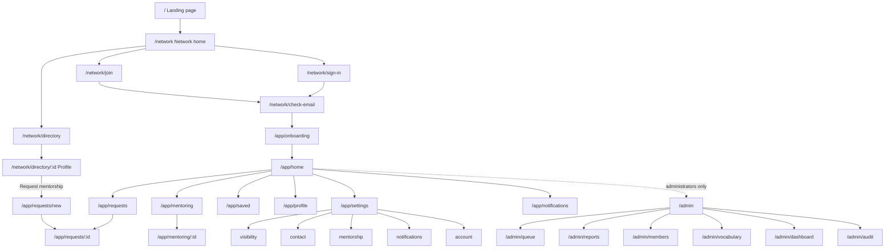

# UX and information architecture: Professional Directory, Networking and Mentorship Platform

This document describes the screens, navigation and flows of the member platform for Muslim Engineers in Science & Tech (MEST): the sitemap, navigation per role, user journeys, onboarding, the mentee, mentor and administrator workflows, how communication and scheduling were evaluated, the notification matrix, empty states and status labels, mobile behaviour and accessibility commitments. Requirements it fulfils are in [01-product-requirements.md](01-product-requirements.md) (IDs such as DIR-4); the data it reads and writes is in [02-technical-architecture.md](02-technical-architecture.md); build order is in [04-implementation-roadmap.md](04-implementation-roadmap.md).

People named in examples (Layla Haddad, Amina Rahman, Fatima Noor and others) come from the prototype's `src/preview/network/data/mock.ts` and are fictional. The prototype at `/preview/professional-network/` shows most of these screens with that data.

## 1. Design principles

1. **Private by default, visible on purpose.** Every screen that could expose a person shows exactly what the viewer is allowed to see and says why the rest is missing ("Sign in to see members-only profiles"). No layout ever has an empty slot where an email address would go.
2. **The directory is the product; mentorship is a verb on a profile.** Members do not browse "mentors" as a separate population. They browse people, and some people can be asked for mentorship.
3. **One request, one person, one topic.** The request form never fans out to many mentors. It is addressed to someone, about something.
4. **Say what state things are in.** Every request, profile and report has a visible status with a plain label and the date it changed.
5. **Same brand as the landing page.** Dark ground, Cormorant Garamond for headings, Hanken Grotesk for everything else, the two purples for actions and rules. The platform reuses the `@theme` tokens in `src/styles.css`. No new palette.

## 2. Sitemap

### 2.1 Nested list

Paths are for the real build with a client router. The prototype uses the same structure after `#/`.

- `/` Landing page (unchanged)
- `/network` Network home: what the directory and mentorship are, who may join, a sample of public profiles, Join and Sign in
  - `/network/directory` Directory list with filters and search
    - `/network/directory/:id` Professional profile page
    - `/network/directory?mentoring=1` Mentors preset (same list, filtered, with topic and audience filters shown)
  - `/network/join` Create account (magic link or Google)
  - `/network/sign-in` Sign in
  - `/network/check-email` "We sent you a link"
  - `/network/guidelines` Community guidelines and how mentorship works
  - `/network/privacy` Privacy notice for the platform
- `/app` Signed-in shell
  - `/app/onboarding` Steps 1 to 5 (kind, basics, details, settings, review); only shown until complete
  - `/app/home` Home: pending items for this person, shortcuts, recent activity
  - `/app/requests` My requests (sent), with status filters
    - `/app/requests/:id` Request detail; after acceptance, the handoff
    - `/app/requests/new?mentor=:id` Request flow (full-screen steps on mobile, side panel on desktop)
  - `/app/mentoring` Mentor inbox: incoming requests, active mentees, completed
    - `/app/mentoring/:id` Incoming request detail with accept and decline
  - `/app/saved` Saved profiles
  - `/app/profile` My profile, with "Preview as visitor" and "Preview as member"
    - `/app/profile/edit` Edit sections
  - `/app/settings`
    - `/app/settings/visibility` Directory visibility and participation
    - `/app/settings/contact` Contactability and methods
    - `/app/settings/mentorship` Mentorship status, topics, capacity, pause
    - `/app/settings/notifications` Email preferences
    - `/app/settings/account` Export data, delete account, sessions (later)
  - `/app/notifications` In-app notification list
- `/admin` Administrator shell (same shell, extra section; only rendered when `admin_roles` says so, and every query is also policy-gated)
  - `/admin/queue` Approval queue
    - `/admin/queue/:reviewId` Review a submission
  - `/admin/reports` Open and closed reports
    - `/admin/reports/:id` Report detail with actions
  - `/admin/members` Members list and search
    - `/admin/members/:id` Member detail (what an administrator may see)
  - `/admin/vocabulary` Disciplines, expertise tags (proposed queue), mentorship topics
  - `/admin/dashboard` Program measures
  - `/admin/audit` Audit log
  - `/admin/administrators` Grant and revoke

### 2.2 Flowchart

## 3. Navigation structure per role

### 3.1 Public visitor

**Header** (matches the landing page header): MEST wordmark, then Mission, Events, Get Involved (landing page anchors), then **Directory** (new), then **Sign in** as a text link and **Join** as the primary button. On the directory pages the header is the same so the visitor never feels they left the site.

**Footer**: unchanged, plus links to Community guidelines and Privacy notice.

Visitors see `public` profiles only. Members-only entries are not listed as locked cards; the count is shown instead: "14 more profiles are visible to signed-in members."

### 3.2 Signed-in member (student or professional)

**Desktop: app shell with a left rail.** The rail is 240px, collapsible to icons with tooltips at narrower desktop widths. Items in order:

| Item | Shown to | Badge |
| --- | --- | --- |
| Home | Everyone | |
| Directory | Everyone | |
| My requests | Everyone | Count of requests awaiting the member's attention (accepted but handoff not yet viewed) |
| Mentoring | Professionals with mentorship `active` or `paused` | Count of `pending` incoming requests |
| Saved | Everyone | |
| Notifications | Everyone | Unread count |
| Profile | Everyone | "Pending review" or "Declined" pill when relevant |
| Settings | Everyone | |
| Admin | Administrators | Queue plus open reports count |

The rail's footer shows the member's name and kind, and "Sign out".

**Mobile: labelled bottom bar.** Five slots, each with an icon and a text label (touch has no hover, so icon-only is not acceptable): Home, Directory, Requests (or Mentoring for mentors, with Requests reachable from Home), Notifications, Menu. Menu opens a sheet with Saved, Profile, Settings, Admin (if applicable) and Sign out. The bar hides when a full-screen step flow is open.

### 3.3 Mentor

Same shell. The "Mentoring" item appears, and Home gains a "Requests waiting for you" block at the top with the oldest pending request first and the days until it expires.

### 3.4 Administrator

Same shell with an Admin section. Admin pages use the same components as member pages, with denser tables on desktop and cards on mobile. Administrators are reminded by a persistent line at the top of admin pages: "Actions here are recorded in the audit log."

## 4. User journeys

### 4.1 A student finds help before a deadline

Amina Rahman, a civil engineering junior, needs a coastal internship for next summer and does not know how licensure works.

1. Lands on `/network` from the landing page header, reads what mentorship is, joins with her university email.
2. Onboarding: chooses Student, enters basics, program and level, goals, interests, topics needed (Internships and first jobs; Professional licensure).
3. Home suggests the Mentors preset filtered to her topics. She filters discipline to Coastal & environmental and sees Layla Haddad, PE, Senior Coastal Engineer, verified, "Taking requests, 1 of 3 slots open".
4. Opens the profile, reads the mentorship section (topics, audience undergrad and grad, 45 minutes, weekday evenings), chooses Request mentorship.
5. Four steps: topic (from Layla's list), why and goals, format and mode, review. Sends. Sees "Pending. Layla has until [date] to reply. You can have 2 more open requests."
6. Six days later: email "Your request was accepted." Opens the request, reads Layla's note, sees the booking link Layla chose to share, books a time there.
7. Later, either marks the relationship completed from the request page.

### 4.2 A professional joins, lists carefully, mentors a little

Zainab Qureshi, a biomedical engineer, wants to be findable but is protective of her time.

1. Joins with Google. Chooses Professional. Enters title, organization (Delta Medical Devices), discipline, years, expertise, education.
2. Settings step: visibility `members` (she is not ready to be on the open web), contact methods: requests through MEST and email, participation: directory, mentoring, collaborating. Mentorship on: two topics, undergrad and grad, one-time, online, 30 minutes, maximum 3 active.
3. Reviews, submits. Sees "Submitted for review. An administrator usually replies within a week. You can still edit."
4. Two days later: email "Your profile is approved and listed." A week after: "New mentorship request." Opens it, accepts, chooses to share email only, writes a note.
5. Three months on, she is travelling. Settings, Mentorship, Pause until a date. Her profile now says "Not taking new requests right now"; her two active mentees are unaffected.

### 4.3 An administrator works the queue on a Sunday

1. Opens Admin from the rail. Queue shows three submissions, oldest first: Dawud Jenkins, Samira Benali, Musa Grant.
2. Opens Samira Benali. Sees the submitted profile exactly as members would, plus the sign-up email domain (a planning commission domain), and marks the affiliation verified by work email. Approves.
3. Opens Musa Grant. A report is attached (filed by a member: "Bio reads like an advertisement"). The bio offers a free consultation. Declines with notes: "Please describe your experience and what you can help students with, and remove the consultation offer." The member receives the notes and can resubmit. Resolves the report with the action "declined in review".
4. Checks the dashboard: 11 requests this month, 9 answered within 7 days, 2 expired. Notes to raise expiry with the board.

## 5. Onboarding flow

Onboarding runs once after the first sign-in. It can be left and resumed; progress is saved per step. Fields marked Public are visible according to the member's directory visibility; Members means visible only to signed-in members regardless of visibility; Private means only the owner, counterparties where noted, and administrators where noted.

### Step 1: Who you are

| Field | Required | Audience |
| --- | --- | --- |
| I am a: Student / Professional | Required | Drives everything after |
| Eligibility and guidelines acknowledgement | Required | Private |

Copy under the choice: "Students include high school seniors, undergraduates and graduate students. Early-career professionals who mainly want guidance can choose Student too; you can change this later."

### Step 2: Basics (both kinds)

| Field | Required | Audience |
| --- | --- | --- |
| First name, last name | Required | Public for professionals; students: visible only to mentors they request |
| Credentials (PE, PhD, MD) | Optional | Public |
| Location (city, state) | Required | Public (city level only; no addresses) |
| Region | Prefilled "Greater New Orleans", changeable | Public |
| Short bio | Required for professionals (min 120 characters), optional for students | Public for professionals; counterparty for students |
| LinkedIn URL | Optional | Shown only if LinkedIn is chosen as a contact method |
| Personal website | Optional | Public |

### Step 3a: Professional details

| Field | Required | Audience |
| --- | --- | --- |
| Title | Required | Public |
| Organization | Required ("Self-employed" allowed) | Public |
| Discipline (one, from the list) | Required | Public |
| Years of experience | Required | Public as a band ("13 to 20 years"), exact number private |
| Expertise tags (up to 12, from the list; propose new) | At least 2 | Public |
| Interests (up to 10) | Optional | Public |
| Education (up to 6 entries) | Optional | Public |
| Participation options | At least "Professional directory" to be listed | Public as badges |

### Step 3b: Student details

| Field | Required | Audience |
| --- | --- | --- |
| Program | Required | Counterparty |
| Level (high school, undergraduate, graduate, early career, mid-career) | Required | Counterparty |
| Institution | Required | Counterparty |
| Goals | Required | Counterparty |
| Interests | Optional | Counterparty |
| Topics needed (up to 5) | Optional | Private; used to suggest mentors |

### Step 4: Settings (professionals only)

Three cards, each with a one-line explanation that they are independent.

| Setting | Options | Default |
| --- | --- | --- |
| Directory visibility | Public / Members / Hidden | Members (board may change; see open questions) |
| Contact requests | Allow / Do not allow; methods: Requests through MEST (always on), Email, LinkedIn, Scheduling link, Phone or text; each method asks for its value | Allow, MEST only |
| Mentorship | Off / On. When on: topics (at least 1), audiences (at least 1), format, mode, availability text, session length, maximum active mentees | Off; maximum 3 when turned on |

Each method shows its note from `taxonomy.ts`, for example "Phone or text: never shown publicly. Shared only with accepted mentees."

### Step 5: Review and submit

Shows the profile as a visitor would see it and as a member would see it, side by side on desktop, tabbed on mobile. Students finish here and land on Home. Professionals see "Submit for review" and the explanation of the queue.

## 6. Mentee workflow

### 6.1 Finding a mentor

- Directory filters (desktop: left column; mobile: bottom sheet): Discipline group and discipline, Expertise, Location, Open to (participation), Mentoring now, Experience, Verified only. Topic and Audience filters appear when Mentoring now is on.
- Search box with debounced keyword search across name, title, organization, expertise and bio.
- Result cards: initials avatar, name with credentials, title, organization, discipline, location, verified mark, up to three participation badges, and for mentors a capacity line: "Taking requests" or "Not taking new requests right now".
- Sort: newest, last active (later), experience (later).

### 6.2 The profile page

Sections in order: header (name, credentials, title, organization, location, verified), About (bio), Expertise and interests, Education, Open to (participation), Mentorship (if active or paused: topics, audiences, format, mode, length, availability, capacity line), Actions. Actions are decided by the viewer and the professional's settings:

| Viewer | Mentorship active with capacity | Mentorship paused or full | Mentorship off, open to networking | Neither |
| --- | --- | --- | --- | --- |
| Visitor | "Sign in to request mentorship" | "Not taking new requests right now" | "Sign in to request an introduction" | Save only (after sign-in) |
| Member | Request mentorship | Not taking new requests; Save | Request an introduction | Save |
| Already has a pending request here | "Request pending since [date]" | | | |
| Already in a relationship | "You are working with [name]. Open request" | | | |

An introduction request (networking) uses the same request flow with topic replaced by "Introduction" and is treated as a one-time request. It appears in the mentor's inbox with an "Introduction" label. This keeps one mechanism for all contact.

Nowhere on the page: email, phone, booking link. The LinkedIn link appears only if the professional chose LinkedIn as a contact method, because that is a public page they already publish.

### 6.3 Request flow

Full-screen steps on mobile, a right-side panel over the profile on desktop. The header of every step says who the request is to.

1. **Topic.** Radio list of the mentor's offered topics (or "Introduction" for a networking request).
2. **Why and goals.** Two text fields with character counts and example prompts: "What made you choose [first name]?" and "What would make this a success for you?"
3. **Format and mode.** Only options the mentor offers; if the mentor set "either", both appear. Optional scheduling note (200 characters): "Tuesdays and Thursdays after 5 work best."
4. **Review and send.** Shows the request and the rules: expires in 14 days; the mentor sees your name, program, institution, goals and this request, and nothing else; you can cancel any time; you have N open requests left.

On send: toast "Request sent to [first name]", and the request detail page. If the cap is reached before step 1, the flow does not open; the profile shows "You have 3 open requests. Wait for a reply or cancel one."

### 6.4 Request detail and handoff

Status block at top with the date. Below it, the request as written. Then:

- `pending`: "Waiting for [first name]. Expires [date]." Cancel button.
- `accepted`: the mentor's note, then "How to reach [first name]" with only the shared methods: Scheduling link (button), Email (copyable, `mailto`), LinkedIn (link), Phone or text (copyable). Then "Mark as completed".
- `declined`: the reason if given, and "You can send a request to someone else." Suggested mentors with the same topic.
- `expired`: "No reply within 14 days. This is not a judgement of you; mentors are volunteers." Suggested mentors.
- `canceled`: the date.
- `completed`: the date, who marked it, and (Phase 2) the feedback prompt.

### 6.5 My requests list

Tabs: Open (pending, accepted), Closed (completed, declined, expired, canceled). Each row: mentor name, topic, status pill, relevant date. Empty states in section 10.

## 7. Mentor workflow

### 7.1 Inbox

`/app/mentoring` has three tabs: **Requests** (pending, oldest first, with days left), **Active** (relationships not completed), **Past** (completed, declined, expired). The header shows the capacity line: "2 of 3 active" and a link to settings.

### 7.2 Incoming request

The mentor sees: the mentee's name, program, level, institution, goals, interests; the request topic, why, goals, format, mode, scheduling note; days until expiry. They do not see the mentee's email or other requests.

Actions:

- **Accept.** A sheet: optional note to the mentee (600 characters); checkboxes for which of their enabled methods to share for this relationship (at least one; "Requests through MEST" is not a handoff and is not offered here). Confirm. The relationship starts; the mentee is notified.
- **Decline.** A sheet: reason (Outside my expertise / No capacity right now / Not a fit / Other) and optional note. Confirm. The mentee sees the reason and the note.

If the mentor is at capacity, the accept button explains: "You are at your maximum of 3 active mentees. Complete one or raise your maximum in settings."

### 7.3 Active relationships

Each card: mentee name, topic, started date, shared methods (as labels), "Mark completed". Phase 2 adds the meetings log and propose-three-times scheduling under each card.

### 7.4 Settings, Mentorship

- Status: Off / Active / Paused. Paused shows an optional date; "Resume automatically on [date]".
- Topics, audiences, format, mode, availability text, session length, maximum active mentees (1 to 10).
- A live line: "Your profile will show: Taking requests" or "Not taking new requests right now".
- Turning mentorship off with active relationships keeps the relationships; it stops new requests.

## 8. Administrator workflow

### 8.1 Approval queue

Table (cards on mobile) sorted oldest first: name, title, organization, discipline, submitted date, days waiting, "Has report" flag. Opening a row shows the submitted snapshot as members would see it, the sign-up email domain (not the full address), the LinkedIn URL if provided, previous reviews of this member, and the actions:

- Mark affiliation verified (method: work email domain / LinkedIn / personal knowledge). Independent of approval.
- Approve. Optional note for the record.
- Decline. Notes required; they are sent to the member. The member can edit and resubmit; the new submission is a new queue row with the old notes visible.

### 8.2 Reports

List: reported profile, reason, filed date, status. Detail: the report, the profile as members see it, prior reports about this profile, and actions: Dismiss (note), Resolve with action: none / hide profile / suspend requests for N days / remove account. Each writes an audit entry. The reporter gets a status email without the resolution note; the reported member gets an email only if an action affects them, and it does not identify the reporter.

### 8.3 Members

Search and filters by kind, approval state, mentorship status, verified, region. Detail shows what the policy allows (no contact values unless a report on this profile is open, and that view is logged). Actions: hide, restore, remove, grant or revoke administrator.

### 8.4 Dashboard

The measures from the requirements, as numbers with a 90-day trend. No charts in the first release; a table with month columns is enough and prints well for a board meeting.

### 8.5 Vocabulary

Three lists: disciplines (add, deactivate, reorder), expertise tags (approve or reject proposals, merge duplicates later), mentorship topics (add, deactivate).

## 9. Communication and scheduling evaluation

The requirement is that a mentor and mentee can get from "accepted" to "met" with as little platform as possible, because every communication feature a volunteer organization builds is one it has to moderate.

| Option | What it would give | Cost and risk | Decision |
| --- | --- | --- | --- |
| Platform-mediated request plus email notification, handoff on accept | One structured ask, one answer, then the mentor's chosen channel | Lowest. No conversation to moderate. Relies on the mentor's own channel | **MVP** |
| Internal messaging | Conversation without exchanging contact details | Moderation, retention policy, abuse reporting on messages, notification fatigue, and it competes with email, which both parties already have | Rejected |
| Propose three times (lightweight scheduling) | A time agreed without a calendar tool | Small table, small UI; useful mainly for mentors without a booking link | **Phase 2** |
| Meetings log | Evidence that meetings happened; the "meetings held" measure | Small; depends on people filling it in | **Phase 2**, with a one-tap "Did you meet?" prompt a day after a proposed time |
| Calendar integration (Google, iCal) | Invites and reminders | OAuth scopes to calendars are sensitive and the review process is heavy; many mentors already use Calendly or Cal.com | **Phase 3, only if** the meetings log shows demand |
| Video calls inside the platform | No third-party links | Far outside the organization's capacity | Rejected |

The handoff principle: on accept, the mentee sees the mentor's note plus the mentor's chosen handoff (booking link, email, LinkedIn, phone). The mentor chooses per relationship, not globally, so a mentor can share a booking link with one mentee and email with another.

## 10. Notification matrix

Channels: In-app (always), Email (subject to the member's preference for that category; account emails always sent).

| Event | Who is notified | Category | In-app | Email |
| --- | --- | --- | --- | --- |
| Request created | Mentor | request | Yes | Yes |
| Request still pending at day 5 | Mentor | reminder | Yes | Yes |
| Request still pending at day 10 | Mentor | reminder | Yes | Yes ("4 days left") |
| Request accepted | Mentee | response | Yes | Yes |
| Request declined | Mentee | response | Yes | Yes |
| Request expired | Mentee | response | Yes | Yes |
| Request expired | Mentor | reminder | Yes | No (they chose not to answer; the in-app record is enough) |
| Request canceled by mentee | Mentor | request | Yes | No |
| Relationship marked completed | The other party | response | Yes | Yes |
| Profile submitted for review | All administrators | admin_digest (immediate if queue was empty, otherwise weekly) | Yes | Per preference |
| Profile approved | Member | profile | Yes | Yes |
| Profile declined with notes | Member | profile | Yes | Yes |
| Affiliation verified | Member | profile | Yes | No |
| Report filed | All administrators | admin_digest | Yes | Per preference |
| Report resolved or dismissed | Reporter | report | Yes | Yes (status only) |
| Moderation action affecting a member | That member | account | Yes | Yes (always) |
| Mentorship auto-resumed after pause | Mentor | profile | Yes | Yes |
| Deletion scheduled | Member | account | No (they are leaving) | Yes (always) |
| Deletion canceled | Member | account | Yes | Yes (always) |
| Weekly administrator digest | Administrators | admin_digest | Yes | Per preference |
| Proposed times (Phase 2) | The other party | request | Yes | Yes |
| Time chosen (Phase 2) | Proposer | response | Yes | Yes |
| Meeting tomorrow (Phase 2) | Both | reminder | Yes | Yes |

Email content rule (NOT-4): subject and body name the event and link to the app. They never include the other person's goals, request text, program or contact details. "A student at a Louisiana university sent you a mentorship request about Internships and first jobs" is the most specific an email gets.

## 11. Empty states and status vocabulary

### 11.1 Empty states

| Screen | Copy | Action |
| --- | --- | --- |
| Directory, no results | "No profiles match these filters." | Clear filters |
| Directory, visitor, members-only hidden | "14 more profiles are visible to signed-in members." | Sign in |
| Directory, early days | "The directory is new. Professionals are being approved every week." | Join as a professional |
| My requests, none | "You have not sent a request yet. Find someone in the directory whose work you want to learn about." | Browse mentors |
| Mentoring inbox, none | "No requests waiting. Your profile says you are taking requests on [topics]." | Edit mentorship settings |
| Mentoring inbox, mentorship off | "Mentorship is off. Turn it on to receive requests." | Turn on |
| Saved, none | "Save profiles you want to come back to. Nobody is told when you save them." | Browse directory |
| Notifications, none | "Nothing new." | |
| Admin queue, none | "The queue is empty." | |
| Admin reports, none | "No open reports." | |
| Request detail, expired | "No reply within 14 days. Mentors are volunteers and sometimes miss a request. Here are others who offer the same topic." | Suggested mentors |

### 11.2 Status labels

| Stored value | Label shown | Colour role |
| --- | --- | --- |
| Request `pending` | Pending | Accent (purple) |
| Request `accepted` | Accepted | Positive (green from the semantic token set, to be added) |
| Request `declined` | Declined | Neutral |
| Request `completed` | Completed | Neutral |
| Request `canceled` | Canceled | Neutral |
| Request `expired` | No reply | Neutral |
| Approval `pending` | Pending review | Accent |
| Approval `approved` | Listed | Positive |
| Approval `declined` | Needs changes | Warning |
| Visibility `public` | Public | |
| Visibility `members` | Members only | |
| Visibility `hidden` | Hidden | |
| Mentorship `off` | Mentorship off | |
| Mentorship `active` (with capacity) | Taking requests | Positive |
| Mentorship `active` (full) | Not taking new requests right now | Neutral |
| Mentorship `paused` | Not taking new requests right now (until [date] if set) | Neutral |
| Verified true | Verified affiliation | Accent icon with text label |
| Report `open` | Open | Warning |
| Report `resolved` | Resolved | Neutral |
| Report `dismissed` | Dismissed | Neutral |

Semantic colours (positive, warning, negative) are new tokens; they must be defined as their own variables, not aliases of the accent, so a palette change cannot change their meaning.

## 12. Mobile behaviour

Mobile is a different layout, not a shrunk desktop. The rules below are checked at 375px and 768px.

- **Filters are a bottom sheet.** The directory shows a sticky "Filters (3)" button and the search field. The sheet lists the same filters as the desktop column, with Apply and Clear at the bottom. The result count updates live in the Apply button.
- **Cards replace tables.** Every admin table and every list becomes a card list with the same fields, the primary action as a full-width button, and secondary actions in an overflow menu with labelled items.
- **The request flow is full-screen steps** with a progress line ("Step 2 of 4"), a Back control in the header, and the mentor's name under the title. The bottom bar is hidden while the flow is open.
- **Accept and decline are bottom sheets** on mobile, side panels on desktop.
- **Profile page** stacks sections; the action buttons stick to the bottom of the viewport above the bar while the profile is on screen.
- **Settings** are a list of sections; each opens its own screen.
- **Touch targets** are at least 44 by 44 CSS pixels; desktop density is higher (32px rows in admin tables).
- **No horizontal overflow** at 375px; this is asserted in the browser tests, not eyeballed.
- The app is installable (web manifest); the installed app uses safe-area insets for the bottom bar.

## 13. Accessibility commitments

The platform targets WCAG 2.2 level AA. Specific commitments, each testable:

- Every interactive control is reachable and operable by keyboard in a logical order; focus is visible on the dark ground (a 2px accent ring with 2px offset, contrast at least 3:1 against both the control and the background).
- Colour is never the only carrier of status; every pill has a text label, and the verified mark has text next to the icon.
- Text contrast at least 4.5:1 for body and 3:1 for large text, measured with alpha compositing against the real background (the panel colours use `color-mix`, so the audit tool must resolve them).
- Forms: every field has a visible label; errors are announced (`aria-live`) and listed at the top of the step with links to the fields; required fields are marked in text, not only with an asterisk.
- Dialogs, sheets and side panels trap focus, restore it on close, and close on Escape.
- Lists announce result counts after filtering ("23 profiles").
- Status changes (request sent, accepted) are announced with a polite live region as well as the toast.
- All images are either decorative (`alt=""`) or have a text alternative; initials avatars are `aria-hidden` with the name adjacent.
- Motion: entrance animations respect `prefers-reduced-motion`; no content is hidden behind an animation that may not run.
- Tables have header cells and captions; on mobile, cards keep the field labels visible.
- Page titles and headings follow the sitemap; each route sets a unique `<title>` and one `<h1>`.
- Language is plain; no idiom or jargon in error messages; reading level checked for the onboarding copy.
- Tested with a screen reader (VoiceOver on macOS and iOS) and keyboard only before each phase is accepted; the roadmap's acceptance criteria name these checks.

## 14. Design tokens the platform adds

To be added to `src/styles.css` `@theme`, derived from the existing palette: `--color-positive`, `--color-warning`, `--color-negative` and their on-colours; `--radius-control` and `--radius-card`; a `--shadow-none` for the dark ground (elevation comes from the existing `--panel-lift`, not shadows). Everything else reuses the landing page tokens.
